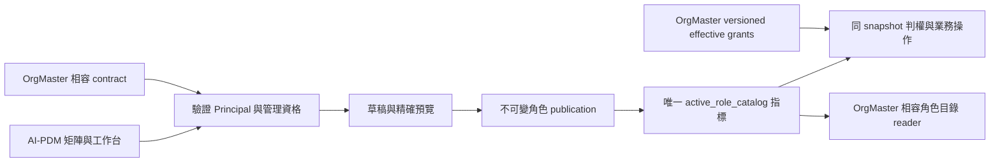

# DEV-123 可增減角色的權限矩陣與角色工作台實作契約

建立：2026-10-12；修訂：2026-10-23（Asia/Taipei）。Owner：`AIPDM/DEV-123#role-permission-editor`。狀態：`Local Implementation In Progress / Rollout Disabled`；本輪已授權PDM branch／PR／required CI及既有protected release workflow的發布與驗收；OrgMaster正式migration/deploy、正式資料／環境操作仍受partner既有人類禁止。結果與缺口統一見QA§6，尚未整體驗收。

本文件是第一版唯一產品及工程契約；[任務板](../dev_task.md#dev-123-role-permission-editor)登錄狀態，[ADR](../decisions/ADR-PDM-ROLE-POLICY-001-versioned-app-owned-authority.md)只記取捨，[QA](../qa/qa-dev-123-role-permission-editor-validation-plan-2026-10-12.md)定義案例與證據。實作沿本輪授權，正式操作限制維持。

## 1. 人類決策與第一版邊界

人類來源：2026-10-12確認JF-FMS操作、OrgMaster人員指派分工、七日常角色／五作業及合併動作，並選擇停用停止授權但保留指派與歷史。10/19同意自用五點精簡；10/22要求COO繼續精簡；10/23授權AI-PDM與OrgMaster隔離工作樹協同開發，並授權PDM branch／PR／required CI／既有protected release workflow發布與驗收；OrgMaster正式migration/deploy、正式資料／環境操作仍受partner既有人類禁止。產品與必要權限保護不變，技術提案替換見§14。

AI-PDM 定義角色業務能力，OrgMaster 唯一管理人員指派、scope、有效期、代理、撤銷及特權任用。權限目錄是 application-global：一次啟用影響所有公司的相同角色，實際存取仍受各指派的公司／專案範圍限制；第一版沒有 company overlay。只有符合 §4 的直接 global 系統管理員能改動這份全系統設定。

包括：七個日常角色及自訂業務角色、五個作業分組、每格獨立的合併動作控制；新增／停用／恢復非受保護角色；生效版本查閱、草稿建立／選取／保存／取消未保存修改、矩陣與單角色工作台、差異預覽、差異確認及一次原子套用、查原操作結果、歷史查閱及從歷史建立新草稿。下載判權、作業辨識與既有caller接入是本版必要的授權改造；不新增模型獨立審批流程或補完退役業務。不新增第二人核准；同一合格管理者可完成套用。

排除：物理刪除／重用角色ID、已發布角色改名／改metadata、複製角色並繼承受保護能力、在AI-PDM任用人員、增加任意capability、修改scope／既有角色優先序／禁止自審、補完未支援業務、中央permission service、JF-FMS修改、Platform／IAM／Secret／traffic操作。

| 顯示順序 | 日常角色 | 權限設定的stableRoleId／roleCode | 舊身份相容與限制 |
|---|---|---|---|
| 0 | RD | `role-rd / rd` | 原displayName「研發人員」保留於身份／歷史，presentationName顯示RD |
| 1 | RD主管 | `role-rd-manager / rd_manager` | 原「研發主管」身份不改；仍驗指定reviewer及禁止自審 |
| 2 | QA/QC | `role-qa / qa` | 合併審核包含最終核准，預設不授審核 |
| 3 | 生產人員 | `role-manufacturing / manufacturing` | workspace與任用期間不改 |
| 4 | 採購／生管 | `role-procurement / procurement` | canonical設定沿用採購ID；`role-production-planning / production_planning`成為source固定的legacy-only相容別名 |
| 5 | 外部專員 | `role-external-specialist / external_specialist` | project-only、manual direct、有限到期、不可代理；只看已交付且明確共享到該project的資料 |
| 6 | PDM管理員 | `role-pdm-admin / pdm_admin` | 業務動作可編輯；管理資格仍受§4 protected任用控制，不能因名稱取得寫入資格 |

七角色是**日常權限profile**，不是刪掉兩筆歷史身份。九既有身份欄位stableRoleId、roleCode、displayName、assignable、risk、subjectKind、recommendationAllowed、delegationAllowed、allowedScopeKinds、assignmentTier、metadata與原displayOrder 0..8精確保留合法基線。另由source registry定義presentationName／presentationOrder、permissionRoleId及assignmentDisposition，不覆寫身份欄位。custom身份在九prefix後append，UI在七日常role後append；catalog順序與UI順序分開。

`system_admin`保留hidden-protected的維運／復原及特權任用身份，不放日常矩陣或一般新增角色選單。全部legacy能力保留；首個dynamic版本增加§3固定20個業務action的source保護值（每code mapped legacy無false時加allowed:true，有false則不加allow並保留唯讀deny），不能由草稿勾選、複製或停用。它不是第八個日常業務角色，也不把global能力轉給pdm_admin。需查受保護身份時以只讀詳細資訊顯示。

採購／生管不新增第十個ID，不重寫OrgMaster指派：production_planning指派先按原ID/code及原history驗任用，判權時只將permissionRoleId指向procurement，原scope／到期／代理／priority slot仍取原指派。canonical與alias的roleStatus須同步，alias不接受獨立能力／狀態編輯；停用／恢復採購／生管一次影響兩種既有指派。既有兩角色的舊permissions保持各自原值，新20個業務action只存canonical，alias不得自行存第二份授權。OrgMaster新任用只選七canonical角色及active custom；舊生管身份可查、可撤銷、有效期間內仍可用。雙角色同時持有仍逐指派檢查scope與原priority，不做scope union或合併任用記錄。

`system_admin`不可停用／刪除／複製；其餘七日常role及custom可停用／恢復，project-only外部專員不得改scope。不可把同Employee的另一Principal視為system_admin。

### 1.0 預設矩陣與首次轉換

下表是使用者已同意的**新政策草稿範本**，圖號、料號、模型／BOM、技轉交付四列各自有同樣起始值；之後逐列、逐動作勾選，互不連動。

| 作業分組 | RD | RD主管 | QA/QC | 生產人員 | 採購／生管 | 外部專員 | PDM管理員 |
|---|---|---|---|---|---|---|---|
| 圖號作業 | 查看、下載、編輯 | 查看、下載、編輯、審核、發布 | 查看、下載 | 查看、下載 | 查看、下載 | 查看 | 查看、下載、編輯、審核、發布 |
| 料號作業 | 查看、下載、編輯 | 查看、下載、編輯、審核、發布 | 查看、下載 | 查看、下載 | 查看、下載 | 查看 | 查看、下載、編輯、審核、發布 |
| 模型／BOM | 查看、下載、編輯 | 查看、下載、編輯、審核、發布 | 查看、下載 | 查看、下載 | 查看、下載 | 查看 | 查看、下載、編輯、審核、發布 |
| 技轉交付 | 查看、下載、編輯 | 查看、下載、編輯、審核、發布 | 查看、下載 | 查看、下載 | 查看、下載 | 查看 | 查看、下載、編輯、審核、發布 |
| PDM管理 | — | — | — | — | — | — | 查看（既有protected資格）、管理（另需§4特權任用）；鎖定 |

不因migration、建立草稿或換成七欄就改生效授權。legacy首次建草稿由server套用這份明確source範本，記`templateId='ai-pdm.seven-role-defaults.v1'`；所有新增20action、合併role、舊動作被替代及審核／下載的語意擴大均列首轉diff，管理者仍須保存、確認差異及套用。不是由舊key做OR推導；QA原先只有審查不會自動取得合併審核。legacy explicit-deny不得被範本解除：其涵蓋的作業action保持唯讀deny，差異列明，須另受控source決策才能解除。dynamic後建草稿從current精確copy，不重套預設。首次套用前只看原legacy真值，以「既有版本」標示，不能把預設範本冒充正式權限。

### 1.1 角色新增、停用與恢復

新增只輸入displayName，NFC/trim後1–80個Unicode scalar，與全部既有／停用角色identity displayName及source保留的presentationName精確唯一，避免自訂「RD」與內建RD重名。server生成UUID，`stableRoleId=role-custom-<uuid>`、`roleCode=custom_<uuid去hyphen>`；不能指定code、既有ID、alias、global／principal或特權metadata。模板assignable=true、risk=normal、subjectKind=employee、recommendationAllowed=true、delegationAllowed=true、allowedScopeKinds=[workspace]、assignmentTier=app_admin、metadata=null，profile為selectable、自指permissionRoleId；零permissions起始，只勾§3的20業務action，不繼承protected/legacy-reference、不提供自訂project/global模板。

生命週期欄位`roleStatus=active/inactive`與assignable身份屬性分離，所有dynamic角色都必填；legacy視為active且不改舊hash。停用只改roleStatus，原permissions與身份保留。草稿停用無授權效果；版本啟用後該角色的direct及delegated授權一律跳過，包含原有管理能力；仍有效的其他角色正常判權，不能因混有inactive grant把整個Principal判為contract mismatch。恢復同ID及同能力，版本啟用後僅當前仍有效、未撤銷、未到期、scope合法的指派／代理再次生效；OrgMaster撤銷或到期者不會復活。

第一版完整publication保留當前base所有身份及inactive tombstones，不提供物理DELETE；恢復不是新增同名／同code角色。source常數上限64個完整候選身份（含九起始、曾啟用後保留的停用角色及本次新增），不是整個history/identity registry的列數限制；超限422 `ROLE_LIMIT_REACHED`，可恢復停用角色，增加上限需source/規格修訂。此上限用於bounded驗證，不掃描人員決定是否允許停用。新增／停用／恢復與勾選先改同一份本地dirty草稿，由一次save原子保存，再一起確認差異→apply；尚未保存的新增項只是client暫存，可取消，並非物理刪除已持久化角色。停用確認清楚說明「啟用後停止此角色授權；保留指派，恢復可能再次生效」，全公司影響人數未知時不猜值。

## 2. 權威資料路徑與歷史盤點

以下是2026-10-12／19設計盤點，**不是正式環境讀回**。10/23起可在AI-PDM與OrgMaster隔離工作樹協同開發；PDM protected workflow發布與驗收依既有要求認列，正式OrgMaster migration/deploy、正式資料／環境操作仍受partner既有人類禁止，兩端正式驗證仍須實際證據。當時AI-PDM main為d3fc1bf72b3630f8a748746c40584e595d396dac，source v7屬開發候選；實作時核對真實installed基線，不用文件釘選的未部署候選替代。現況及原批次狀態依[DEV-121](DEV-121-target-authorization-boundary.md)。

先前外部只讀盤點metadata（2026-10-12）：OrgMaster `master / 49e25a7e422ef6f224037b497693a2732429a447`，JF-FMS `codex/對接orgmaster及platform / 5c970c734c02d75f9675757fd9adaeec672b7308`；HEAD不代表正式部署。讀取的是現有工作區檔案；兩repo dirty status因sandbox限制未能可靠讀回，標UNKNOWN，不宣稱clean或檔案全等於HEAD，後續owner重新核對。10/23協同開發限隔離工作樹與本機證據，不延伸為正式migration/deploy。

當時的 [catalog reader](../../src/lib/jenfu-principal-role-catalog.ts)把 DB active publication 與 bundled v7 精確比對；[workspace](../../src/lib/ai-pdm-published-role-capability-workspace.ts)與[UI](../../src/components/access-governance/role-capability-settings.tsx)唯讀。舊 `/role-capabilities/preview`、`/publish` 是退役跨 owner mutation，仍回 410。新功能使用獨立 `/role-policies` API。

055 建立的目錄表經 [062 schema boundary](../../db/postgres/062_dev010_neutral_schema_boundary.sql)移入 `ai_pdm_core`；不得依舊 055 名稱在 contract schema 再造一組表。

不新增第二份 permission override 或 per-request OrgMaster HTTP。每次受保護請求從同一 PostgreSQL snapshot 讀 active catalog、Principal／任用與資源；授權失敗／依賴未知即拒絕，不補入 cookie、legacy role 或舊版本能力。

雙reader以**該snapshot的active publication format**決定整次operation：合法legacy-static-v1沿原66key及既有caller/scope/share語意，source v7不能取代真實installed artifact；合法grouped-v2 dynamic才切新20action/profile/delivery/project guards。部署後仍為legacy active期間，不因缺20code中斷原業務；新動作只有dynamic apply commit後才授權。dynamic缺grant／hash/schema失敗絕不試legacy或舊指派能力；禁止混合format判權。QA36/46以雙分支及原session首轉證明。

## 3. 作業、動作及後端權限對應

### 3.1 固定作業與動作 registry

規劃source檔 `config/access-control/role-policy-editor-registry.v2.json`，contract=`ai-pdm.role-policy-editor-registry.v2`，roleSchemaId=`ai-pdm.role-schema.flexible.v2`。前版v1只存在文件，未建立／部署，本輪直接修訂規劃版本；不得把此文當已發布schema。registry固定含roleProfiles、defaultTemplate、businessActions、legacyBindings、protectedBindings。profile列含stableRoleId、permissionRoleId、presentationName/Order、assignmentDisposition=`selectable/legacy-only/hidden-protected`；custom按固定模板推導，不接受body配置alias。

| groupId／作業列 | 範圍 | 同一role格內的獨立控制 |
|---|---|---|
| drawing／圖號作業 | 圖號、圖面、版次、附件及圖面辨識 | 查看、下載、編輯、審核、發布 |
| part／料號作業 | 料號、屬性、版次、附件及料號辨識 | 查看、下載、編輯、審核、發布 |
| model／模型／BOM | 模型檔、結構、零件關聯、model-basis及共享模型 | 查看、下載、編輯、審核、發布 |
| transfer／技轉交付 | 技轉套件、交付包、製造基準及採購接收資料 | 查看、下載、編輯、審核、發布 |
| admin／PDM管理 | 角色政策與既有設定；人員指派連至OrgMaster | 查看、管理；均protected唯讀，管理依§4資格 |

四個業務group × 五個action=`20`個可配置code，kind一律action，精確code為`pdm.<groupId>.<view|download|edit|review|publish>`；例`pdm.drawing.edit`。不得由label、任意前綴或使用者payload產生未註冊code。admin沒有可編輯的新code，沿用protected判權。每個businessAction含groupId/actionId/labels/order、kind/code、supportedScopeKinds、routeBindings/callerBindings、legacyOperationBindings、preservedGuards及byteDeliveryClass；所有method/operation discriminator及server resource resolver均須列入source。唯一checkbox key=`stableRoleId:groupId:actionId`，唯一業務code=`action:pdm.<group>.<action>`。

現有[active-capabilities](../../config/access-control/jenfu-active-capabilities.v1.json)的66key是**只讀盤點基線**，不是新畫面的66項。dynamic新增20key，registry共86個code：20業務editable、57 legacy-reference、9 protected；system_admin對20key是額外per-role protected值，不重複計code。9 protected固定為`accounts.identity.manage,accounts.invitation.manage,accounts.lifecycle.manage,accounts.session.revoke,settings.admin_matrix,settings.integration.manage,settings.manage,settings.secret.manage,settings.storage_evidence.view`，其餘原66中的57個key全部legacy-reference，原值保留、不再直接勾選。前版33editable/24reference分類已被取代，不能以舊33 coverage作新版本PASS。

### 3.2 動作的精確語意

| actionId／顯示 | 包含 | 不可由此動作取得 |
|---|---|---|
| view／查看 | 該作業允許範圍的清單、搜尋、內容、狀態與安全預覽；集合逐資源篩選 | 原檔／CAD／ZIP／CSV下載、編輯、審核、發布 |
| download／下載 | 原檔、附件、模型、BOM匯出、交付包及該作業匯出結果；仍須同作業view | 不繞過共享／資源範圍；不自動開啟編輯 |
| edit／編輯 | 建立、修改、附件增修移除／恢復、辨識執行／人工校正／正式化、草稿取消／作廢、送審及撤回送審；依既有合法狀態 | 最終審核或發布；不允許任意刪已發布主資料 |
| review／審核 | 原審查、審閱、核准、駁回、退回及合法決策套用；指定reviewer且禁止自審 | 發布；管理任用／特權 |
| publish／發布 | 已審核資料正式發行、交付／製造基準發行及既有發布失敗重試 | 不替代審核、不跳狀態、不新增supplier或外部分享任用 |

編輯及審核各是一個完整的業務動作，不把old keys拆成可另勾子項。授予edit讓所有已支援的create/update/submit/withdraw caller採用同一code；授予review同時涵蓋審查和最終核准，不能只保留review不含approve卻顯示勾選。業務target/owner/指定reviewer/no-self及流程狀態仍逐操作驗證。download須view AND download，其他四動作不互相自動授予；UI依view gate開作業頁，直接寫API仍檢查該action及既有domain guards，不以可開頁替代action。

指定reviewer的選擇／資格查詢在dynamic改用target所需review capability、有效scope及原human／業務條件，不能僅靠固定rd_manager/qa enum而讓合法custom角色永遠不能審核；不自動指派reviewer。實際決策仍須原request指定者、no-self及狀態；legacy保持原資格。CG123-01含正常custom reviewer正例。

### 3.3 既有能力及caller映射

下表舊code省略kind時為action；page另外註明。它是**caller語意對應**，不把同一個泛用old key複製成兩份新授權。dynamic caller只向當前publication請求新code，old allowed:true不作fallback；舊explicit-deny仍是限制。帶多類資源的操作須逐target／sub-operation取必需code，不能選一個較寬的group放行。

| target／新code | 既有code或交付面 | server選group及額外guard |
|---|---|---|
| drawing.view | page `numbering.drawings.view`；`numbering.workspace.view,submission.view,approval.inbox.view`的圖面讀取；drawing workbench/history/preview | 由canonical drawing ID、drawing-revision-work或review target決定drawing；只回合法圖面結果 |
| drawing.download | drawing附件／revision-files、`pdm/file-assets/[fileAssetId]`原檔、圖面export結果；原page/view檢查不再足夠 | 資產與圖面／parent關聯由DB決定，view AND download；匯出建立及結果取回都重驗 |
| drawing.edit | `numbering.create,numbering.attachments.manage,numbering.candidate.review.submit,numbering.draft.obsolete,numbering.draft.update,numbering.duplicate_check,numbering.link_variant,numbering.task.update,numbering.notification.update,numbering.workspace.create,numbering.workspace.update,numbering.workspace.cancel,numbering.approval.request,numbering.approval.batch.create,numbering.recognition.run,numbering.recognition.review,numbering.recognition.formalize,pdm.file_metadata.detect,post_release_change`的drawing操作；`submission.create,submission.update`同類target | 圖面target及既有draft/work state；辨識是編輯內的校正，不是業務最終審核 |
| drawing.review | `numbering.drawing_revision_lifecycle_review,approval.request.decide,approval.request.apply,numbering.draft.admin_confirm,submission.review,submission.decide,submission.lifecycle.decide`的drawing target | 指定reviewer/no-self/允許review kind；admin_confirm只限原業務確認，不接設定特權 |
| drawing.publish | `numbering.publish,submission.retry`的drawing發行；既有已審核版次正式採用 | approval已通過＋版次／併發guard，不以edit/review代替 |
| part.view | page `numbering.search`；`numbering.workspace.view,submission.view,approval.inbox.view`的part讀取；parts workbench/search及part matrix基本屬性 | canonical part/root target；集合依各row的group及scope篩選，不能整包跨group回傳 |
| part.download | part附件／submission files、料號匯出／報告；`numbering.export.create,numbering.audit_report.generate`及page `numbering.reports`所產生的part bytes | view AND download；純報告資料可view，CSV/ZIP/原附件為download，不靠page reports |
| part.edit | drawing.edit欄所列泛用numbering/recognition/submission能力的part分支，加`obsolete_part_root` | canonical part-change-work/root、草稿作廢及既有生命週期；不能因drawing.edit寫part |
| part.review | `approval.request.decide,approval.request.apply,numbering.draft.admin_confirm,submission.review,submission.decide,submission.lifecycle.decide`的part／lifecycle target | review kind／指定reviewer/no-self；未遷移kind仍fail closed |
| part.publish | `numbering.publish,submission.retry`的part正式發行／既有發布重試 | 既有核准、發行狀態及canonical identity |
| model.view | `pdm.shared_model.view`；model-basis、BOM/relations與shared-model清單；對應part matrix中的model結構片段 | model owner／BOM parent從DB辨識；不能將part.view當model.view，回應欄位須裁剪 |
| model.download | shared model原檔、CAD、BOM export與含模型的package bytes | model.view AND model.download；若包內同時含drawing/part檔，逐類加view/download |
| model.edit | `pdm.shared_model.manage`；model-basis/BOM結構／零件關聯及模型附件的修改 | model.edit；若同時改parent料號或圖面，另需parent.edit；既有worker最終採用重驗 |
| model.review | 既有drawing/part/submission/review package中**確有模型／BOM審核target**的`approval.request.decide,approval.request.apply,submission.review,submission.decide` | model.review AND 所屬parent.review；沿既有審核流程，不創新model狀態或審核入口 |
| model.publish | 既有drawing/part/transfer發行中**實際發行模型／BOM快照**的`numbering.publish,transfer.package.publish,manufacturing.baseline.release,submission.retry` | model.publish AND 所屬parent.publish；僅引用既有已發布快照不要求重發布 |
| transfer.view | `transfer.package.view,handoff.published.view,manufacturing.baseline.view,integration.procurement.view,submission.view`的技轉資料 | transfer／published release package／baseline的company與target；resolve POST屬讀取不是編輯 |
| transfer.download | handoff/technical-transfer exports、release-package、integration procurement package、製造包及submission release-package bytes | transfer.view AND transfer.download；含原始設計檔的包另驗對應drawing/part/model下載 |
| transfer.edit | `transfer.package.create,transfer.package.update,transfer.package.review.submit,transfer.package.review.withdraw,manufacturing.baseline.manage`與技轉target的`submission.create,submission.update,submission.share` | 原draft／收件人及平台share guard；edit不新增外部人員／任用，不改public share authority |
| transfer.review | `approval.request.decide,approval.request.apply,submission.review,submission.decide,submission.lifecycle.decide`的transfer target | 既有transfer review package kind、指定reviewer/no-self |
| transfer.publish | `transfer.package.publish,manufacturing.baseline.release,submission.retry`的交付發行 | 已核准／可發行及併發guard；integration同步不由此啟用 |

剩餘特殊legacy操作明確處置：
- `approval.request.cleanup`維持原受控清理資格／kind限制，不轉成任意role的edit/publish，不新增清理權。
- `integration.procurement.manage`維持既有integration管理資格且還需transfer.edit；矩陣edit不授連線／同步管理特權。
- page `numbering.request,numbering.tasks`只決定既有導航／展示；dynamic各資源的view/edit gate決定可見與可做，不以page grant放行資料或寫入。
- `submission.share`沿既有受控共享contract；建立/撤銷分享需transfer.edit及每target的view，配送原檔需相應download。`/api/public/shares/[token]`及package在現行Principal模式**仍要求verified session**（見principal-readonly-share.ts），不可改成匿名；token證明已提供該分享、不是矩陣授權。final delivery每次驗當前接收Principal的policy/grant及分享expiry/revocation，不能靠token或舊policy快照補權；supplier回覆等未發布能力仍拒絕。

以上20列加特殊處置覆蓋原66key的語意；完整method/caller及資產delivery清單須在PDM-S1寫入registry、以`CG123-02`逐現有source路徑核對。沒有caller或Principal仍退役/不支援者明列`unsupported-retired`並保持原拒絕，不能新造success、新增業務流程或聲稱已支援。既有caller缺guard是PDM-S3必修；任一實際可用路徑無映射／下載未分類，禁止套用新policy，不可用「reference-only」迴避。此文件表是設計契約，不是20action已有runtime enforcement的證據。

### 3.4 格子、scope及判權

- 狀態為`granted/absent/explicit-deny`，protected／unsupported-scope／legacy detail有readonlyReason。editable勾選存`{kind:'action',code:'pdm.<group>.<action>',allowed:true}`；取消只移除該allow，不新增false。未知code／aliasID／hidden-protected變更拒絕。
- legacy-reference舊entries及explicit-deny從baseline server copy。任一profile成員（含採購／生管alias）的mapped舊key明確false，該profile/action唯讀deny，不能被新allow覆蓋；old true不授新action。sysadmin新增20個固定保護action由source規則給值，mapped explicit-deny同樣保留限制；不讓UI修改。
- 四group view支援workspace、受控project與system_admin原global；download/edit/review/publish只workspace及protected global。external四列只可配置view，其他動作unsupported-scope唯讀；project view只走下文§3.6的已分享交付projection，不開一般內部workbench。custom只workspace，checkbox不改任用scope。
- 圖號／料號／模型／技轉group由server canonical resource及operation discriminator解析；create時從已驗父資料／固定route type解析，不信body.groupId或檔名、副檔名。缺resource owner、混合batch有未授target、未知entity type一律拒絕；寫batch原子全允許才寫，read集合只投影合法資料，不回未授數量／模型欄位。
- runtime沿現有priority-first evaluator：先驗每個原指派的身份／provenance，再解析permissionRoleId、檢查canonical及alias active、scope／期間；維持**原roleCode的priority位置**選第一個有new code的候選，absent跳過，false deny。source alias只production_planning→procurement一條，不循環、不任意轉system_admin；不合併scope/期間、不FMS union。custom按catalog順序在已驗DB完整legacy priority後append；仍只檢查實際指派的roleCode coverage，不寫priority表或以DEFAULT補序列。
- 新20code與page/action舊code的兼容映射只在source guard adapter，不是第二份permission overlay；dynamic authority始終為當前publication。lookup(new code)若profile有mapped frozen false，先回唯讀derived-deny（不新增false entry），即使新code absent也按原priority的明確deny處理；反之只取新allow/absent，不從old true推授。inactive只跳過該role，不能poison其他合法role。owner／reviewer、no-self、company隔離、流程及worker最終採用繼續檢查。

### 3.5 查看與下載的交付邊界

查看只能拿server產生的非原始安全縮圖／預覽衍生物及授權文字資料；把原PDF/CAD/附件以inline disposition返回、前端hide下載鈕、改檔名或同URL加preview參數，都仍屬download。純查看者若該格式沒有安全預覽，只顯示metadata及「無可用預覽」，不能回原bytes。此設計限制server交付原檔，不能防止有權查看者截圖／抄錄；不承諾DRM。

所有原檔／ZIP／CSV／CAD／BOM／release-package、Range請求、縮圖fallback、簽名URL、worker export及public share package均列byteDeliveryClass=`safe-preview/original/export-package`。original/export-package在建立任務、下載授權及**實際讀bytes**前fresh查active policy與source grant；不得發出可繞過下一請求撤權的長效公開／bearer URL。本版原檔由驗證後的應用delivery proxy取得，無新增object簽名/IAM/key權限；既有storage create/get-only限制保留。已在授權snapshot開始的read可完成，下一個GET／Range必讀新policy；不宣稱可追回已下載檔。包內全部實際配送檔必須逐group有view+download，不默默以部分權限漏檔產生錯誤交付包。

### 3.6 外部專員的project-view資料契約

source现況：`submissions.project_code`已有專案字串，`readonly_shares`只綁submission/token/到期而沒有project audience binding；workspace permission service目前projectCode=null。不能宣稱這已是project enforcement，也不能用company workspace當project。

本版forward-only在既有`ai_pdm_core.readonly_shares`增加`project_scope_key text nullable`（非空時不得空白；immutable，禁止runtime UPDATE），**舊列保持NULL，不回填、不由migration替舊token擴權**。既有建立分享API在合法share/transfer.edit及parent guards通過、locked Released submission／release package完整時，server從DB的非空project_code精確copy到此欄；body傳project_scope_key／projectScopeKey拒絕，無專案則NULL。既有share DTO可回`projectScopeKey`摘要供說明，不作人員任用或另外指定project。runtime僅在既有合法share INSERT時寫此欄；撤readonly_shares table-level UPDATE並只回授既有合法revoke/count/metadata欄位（依實際source列出），不回授project_scope_key，trigger禁止修改binding；SQL immutable trigger及column ACL列QA25/51。此欄不另建表、不寫OrgMaster project/grants；重新提供分享才產生新的binding。

外部入口沿既有`/share/[token]`→`GET /api/public/shares/[token]`，登入後由share token正常查看（不以猜token或直接URL代導航驗收）。server同snapshot驗Principal/company、token hash、share active且未到期未撤銷、submission Released、release package/manifest與原canonical target合法；取得非NULLproject_scope_key，與**當前DB submission.project_code及OrgMaster該原指派scopeKey精確相等**，不自行大小寫／前綴轉換或跨company推論。缺／不同／未知則拒絕；project碼更改不能用舊分享擴到新project。

只讀對照[OrgMaster v4 projection](../../../OrgMaster/db/migrations/029_dev057_human_business_principal_grants_v4.sql)：scope_key取原assignment.scope.value；validation.scopeKey()的project:value是治理去重鍵，不是PDM接收的scope_key。本契約比較raw scope.value與DB project_code，UI可說明專案碼必須一致；不在PDM改寫原任用或自行補前綴。這是工作區source證據，不是live provider讀回。

得到typed `ExternalProjectReadContext={principalId,companyId,originalAssignmentId,projectScopeKey,shareId,submissionId,releasePackageId,releasePackageSha256,decisionAt}`，全部server取得，不接受body authority。只回交付manifest／Released submission中各group授權的metadata、BOM/模型清單與既有安全預覽；沒有model snapshot/合法refs只回該交付的模型檔metadata，不能追到未交付內部live模型。逐欄／資源檢查group.view，不回未授內容及download URL。不列舉其他active分享或以project.view讀內部draft/search/workbench；沒有安全預覽不補原bytes。原package API仍驗Principal與token，再要求view+download，external預設且本版scope不支援download所以拒絕。

內部role正常導航不變；external正常登入可保留待開分享連結回到此入口。QA51的P1/P2／NULL舊share／project code改變／多group與到期／撤權都走此delivery path。無token或只持workspace時不能藉project勾選取得資料。

## 4. 管理資格與 request 安全

保留既有session v2、typed active Principal、account/company/authEpoch、session registry及published-grant檢查；不另建任用或可自行勾選的管理grant。

| 操作 | 必要資格 |
|---|---|
| workspace／草稿／差異／歷史 | 當前合法settings.admin_matrix或下列管理者；server裁剪actor/reason及跨公司人員資訊 |
| 建立／保存／套用 | 當前human_privileged Principal的direct global system_admin指派；沿既有protected validator，等待管理鎖後及真正寫入時重驗 |
| 套用結果查回 | 有當前read資格的原操作者或合格global管理者；重試套用仍須當前寫入資格 |

同一合格管理者完成設定，不新增第二人核准。PDM管理員名稱、另一Principal、推薦／代理、workload、users.role=admin、前端旗標或body actorId均不能取得global資格；矩陣不能停用system_admin或改任用scope。DEV-035 manager fence（管理鎖等待後，實際寫入前重驗actor、資格及當前版本）保留；本輪不預先固定新的SQL函式簽名。

POST沿既有[Origin規則](../../src/lib/request-origin.ts)、session及application/json檢查；不新增Secret或信任任意Host。拒絕未知／重複欄位、非法role/action、矛盾change、unsafe integer及過大輸入；actor/company從server context取得。參考bound沿用64身份、名稱1–80及理由1–240 Unicode scalar、request 512KiB／candidate 1MiB，RD可於同slice調整具體輸入格式並同步測試，不能因此擴大可授能力或揭露範圍。

## 5. 資料與對外契約

### 5.1 唯一事實來源

生效內容只有既有 `ai_pdm_core.role_catalog_publications / role_catalog_entries / active_role_catalog`；草稿不授權，套用建立新immutable publication並切換唯一pointer。publication格式與保護metadata放在既有header，角色狀態放在entries，不再另存相同生命週期的metadata。

現行契約是AI-PDM producer與OrgMaster consumer的contract pair；producer manifest列出的34欄是目前欄位基準。參考新增三個資料集；表名／索引／拆合可由RD等效選擇，以下責任與唯一性才是契約。SQL ACL仍在收斂，不在本文寫定新的函式簽名。

| 資料 | 必須保存及保護的事實 |
|---|---|
| `role_policy_drafts` | draft_id UUID PK、created_by、immutable建立binding（base及可選history來源）、base version/hash、registry_hash、完整候選roles、revision、OPEN/APPLIED、timestamps、template來源及已套用版本／request引用。一revision只有一份內容；APPLIED後內容不可改，一draft最多一個publication |
| `role_policy_role_identities` | stable_role_id PK、role_code UNIQUE、NFC display_name UNIQUE、不可改identity／hash、首次publication引用。九基線先登錄，custom於apply首次claim；已發布ID/code/名稱不重用，presentation保留名由source檢查 |
| `role_policy_commands` | **只記成功apply**：request_id UUID PK、actor、exact request_hash、draft_id UNIQUE、前後版本引用、diff、reason、applied_at。同交易append-only；結果DTO可由紀錄與publication重建，不另存第二份audit、失敗狀態或create/save命令 |

既有publication新增／重用format、canonicalization/schema/profile、baseline/identity/protected/registry hashes、draft/base及apply request引用；dynamic必填，legacy新增欄可NULL。entries的role_status保留inactive tombstones、alias同步及system永遠active；既有 `readonly_shares.project_scope_key`依§3.6新增且immutable，舊列NULL不回填。

**不新增role_policy_state、DISABLED/ENABLED/PAUSED、enablement binding或activation_generation。** active format已能判斷legacy/dynamic，版本ID唯一且retired不重新啟用，version/hash CAS足以避免回切及衝突；不為同一事實再維護一個counter。此變更只撤回尚未實作的DEV-123提案，不刪任何已部署契約欄位。

草稿／版本列表採bounded分頁、詳細內容按需載入；本版不加自動清理worker，不刪已發布角色、publication或成功套用歷史。

### 5.2 canonical hash 與授權讀取

dynamic沿既有[canonical-json.v1](../../src/lib/role-capability-canonical-json.ts)及[server SHA-256](../../src/lib/role-capability-canonical-hash.server.ts)。roles按原displayOrder，custom append、inactive留位；permissions按kind:code、scope kinds按ASCII、metadata缺失為null，物件key canonical排序；先驗Unicode與safe integer，不靠jsonb插入順序或localeCompare。

保留對外需要的精確hash，不另發明私有副本。H為上述canonical JSON的UTF-8 SHA-256；身份欄位是§1九角色所列原欄位及合法custom模板，displayOrder取roles array index。

| 對外hash | canonical輸入 |
|---|---|
| roleDefinitionHash | 身份欄位＋roleStatus＋permissions，不含自身hash |
| baselineRoleIdentityHash | 起始九角色身份array，永久固定 |
| roleIdentityHash | 當前完整身份array，不含status／permissions／roleDefinitionHash |
| roleProfileHash | 完整source推導roleProfiles，按同一roles順序 |
| protectedPolicyHash | {systemAdmin:固定擴充角色（不含衍生roleDefinitionHash）,frozenEntries:其他baseline角色全部legacy-reference／protected／explicit-deny entries}；不含非system的status或可寫20action，custom凍結內容必空 |
| registryHash | contractVersion、roleProfiles、defaultTemplate、businessActions的group/action/code/editClass/scope/交付限制、legacyBinding的kind/code/resourceKind/operation→required actions、protectedBindings；各array按stable ID／語意key作ASCII排序 |

registryHash不含私有route/caller/helper路徑、測試名或證據時間；接線由CG123-02驗證。system固定擴充及mapped false規則依§1/3，不能由草稿改寫或從old true補權。

publication的contentHash/catalogSha256仍為H({format,applicationId,candidateCatalogVersion,roleSchemaId,roleProfileSchemaId,registryHash,baselineRoleIdentityHash,roleIdentityHash,roleProfileHash,protectedPolicyHash,roles,roleProfiles})，不含自身hash；actor/reason/time入異動紀錄。身份、system固定20action及mapped false保護依§1/3驗證，新custom frozen entries必空。**不另持久化draft contentHash或confirmationHash，也不要求client重送這兩種hash**：draft revision唯一綁內容，base version/hash唯一綁原政策；preview與apply用同一server validator/diff，apply鎖定後重驗。

legacy v5/v6/v7保留原bytes/hash及核准artifact比對；dynamic嚴格重算對外hash、九身份/custom模板/status/profile/frozen內容及registry。每次新受保護請求讀DB active version/hash與當前grant，不cache active pointer或授權結論；只可memo本request或cache以不可變version/hash為key的內容。dynamic失敗不試legacy、cookie或舊allow。

### 5.3 versioned projections

`ai_pdm_contract.v_application_role_catalog_v2`保留v1身份欄位，加format/canonicalization/schema、baseline/identity/protected/registry hashes、role_status及profile schema/hash、permission_role_id、presentation_name/order、assignment_disposition。dynamic publication_format=dynamic-policy-v1、legacy為legacy-static-v1；dynamic為9..64完整身份，九legacy為prefix，inactive不漏列；header/row/hash不一致即依賴失敗。

legacy九列及原hash不變，profile schema/hash為NULL、permission_role_id自指，presentation沿原name/order；dynamic才採七profile/alias。v1原欄位及同一pointer不變，不把它凍結在舊版本。`v_role_policy_publications_v1`提供相同語意的immutable history與base/lifecycle，不揭露draft或actor/reason。原OrgMaster grants v4不改；任用原catalogVersion是provenance，不必等於current policy。

v2/history/profile是外部兼容契約；breaking變更仍需新version及相容窗口。尚未部署的v2提案不增加generation/readiness欄位；任何已發布舊欄位不得以此精簡直接移除。

### 5.4 forward-only 與 DB 寫入邊界

未來只在db/postgres新增當時未用ordinal的forward-only migration；核對實際installed基線、九身份及保護內容後擴充三資料集、既有欄位與contract views。**migration不改active pointer、不套預設矩陣、不改legacy bytes/hash、priority或OrgMaster grants**；未知基線停止該遷移，不順帶執行其他migration。

只改ai_pdm_core/ai_pdm_contract。runtime不得直接改publication/entries/pointer/identity，不得有owner/DDL或sibling core權限；草稿有bounded寫入，成功套用紀錄append-only。以narrow管理DB操作或等效最小權限邊界完成apply；實際table/column/inherited ACL與immutable負例必驗，不能用固定helper數量代替安全。若用SECURITY DEFINER，固定安全search_path、schema-qualified、無任意SQL、撤PUBLIC EXECUTE。分享binding欄位ACL依§3.6。OrgMaster僅SELECT必要contract，無PDM core/DML/helper權限。

## 6. API 與衝突／復原

參考前綴`/api/settings/access/role-policies`，no-store；沿既有錯誤code/correlationId慣例。私有路徑、DTO及envelope名稱由RD同slice統一，不為未實作提案維護v1/v2/v3平行版本。

| 操作 | 最小binding／結果 |
|---|---|
| GET workspace、draft列表／詳情、publication列表／詳情 | 當前read資格；active version/hash、roles/profile/groups、admission、saved revision、base及applied引用；列表bounded，server裁剪資訊 |
| POST drafts | 新draftId、expectedActive及可選history來源；server固定建立binding，回OPEN/revision1；同ID同actor/建立binding讀回既有草稿，不重套範本，不重建第二份 |
| POST drafts/[id]/save | expectedRevision、typed roleChanges/changes；一次保存、revision+1、回roleBindings。revision衝突拒絕，語意相同可no-op，不允許無變更卻回寫舊資料 |
| GET drafts/[id]/preview | expectedRevision；server重算並回精確diff及confirmation={draftId,draftRevision,expectedActive}，只對saved OPEN/current-base有效，不寫DB |
| POST applications | requestId、confirmation及reason；重驗當前資格／locked draft內容／registry／active CAS；一次commit新publication、pointer、APPLIED及成功套用紀錄 |
| GET commands/[requestId] | 當前資格；成功原結果與current分開顯示。不存在只表示尚未觀察到，不能推定未commit |

`ActiveTuple={catalogVersion,catalogSha256}`；新版本由server以`ai-pdm.role-policy.<draftId>`唯一產生。preview的draft revision及expectedActive已唯一綁定所見差異；apply重驗、重算，不另發token／hash／TTL或查OrgMaster readiness revision。draft保存時可仍為舊base，但preview/apply需current相符；衝突保留dirty，不能force或silent overwrite。source registry語意已改時，舊草稿需重新建立／確認，不在舊binding上偷偷換語意。

roleChanges只含create/deactivate/reactivate；create給clientRoleId/displayName，server生成正式ID/code及固定模板。changes是{roleRef,groupId,actionId,enabled}，roleRef只能是既有stableRoleId或同批clientRoleId之一。兩array可空但不得省略成「清空」；先建role/status再套20action，alias/system/未知/唯讀/重複矛盾項整批拒絕。既有active或同批reactivate可編輯；仍inactive不能改。roleBindings={clientRoleId,stableRoleId,roleCode}隨saved草稿可讀回。

legacy首次草稿用§1.0明確範本，dynamic從current copy；history恢復只從verified grouped複製可編輯動作，保留current身份/status/frozen內容，inactive需明確reactivate。legacy/未知history只讀，不OR推權。

### 6.1 三種寫入，只有套用需要不可變命令

- **建立草稿**以draft UUID及immutable建立binding防重。名稱/ID/code仍由server驗證或生成；client不能提供正式角色ID/code或權限metadata。
- **保存草稿**鎖同draft並比較expectedRevision，原子寫角色與能力。同revision最多成功一次；server保存必要clientRoleId→正式ID對照，遺失回應可GET草稿取回，不需要save command ledger或重播舊patch。
- **套用權限**以request UUID＋actor＋exact typed payload hash防重；先驗當前資格，再查成功紀錄。同ID相同binding回原結果，不重驗舊候選或重執行；不同binding拒絕。未觀察到紀錄才走候選／active CAS。同draft唯一publication；鎖等待後重驗當前session/grant與候選，claim identity、寫publication/entries、舊版retired/切pointer、draft APPLIED及command/diff全部同交易。沒有半套或無紀錄的生效版本；失敗只留既有錯誤診斷，不新增REJECTED/PENDING命令狀態機。

create/save回應遺失先GET草稿；已有較新revision就顯示server目前內容與本地dirty供明確處理，不自動重送舊patch。apply回應遺失查原request或draft.applied引用/history；未知不猜成功／rollback，不換新ID自動重送。只有原apply ID/payload可得且當前資格合法時才重試；原紀錄與current可能不同，均須如實呈現。

apply只有語意diff時建立版本；新UUID/time/version本身不算變更，純role/status變更及首次legacy→dynamic仍算有效差異。管理競爭採必要row-lock/unique/CAS及既有provider retry；不讓一般business取全域policy鎖。重試需fresh snapshot，callback不得有不可回復外部副作用；等待後不可用舊snapshot猜紀錄不存在。

401/403重驗身分／資格；404重讀選取但command不存在不等於rollback；409保留dirty、讀server現況與差異；422/413就地顯示非法項／限額；503或回應不明先讀回，不自動反向恢復。這些沿現有API錯誤處理，不另建命令調度器。

### 6.2 browser 不承擔正確性

saved draft、revision、applied引用、publication與成功套用紀錄是server真值；sessionStorage至多是可選draft/request提示。不可用／quota／損壞仍可保存與套用，不保存完整命令body，不把持久化成功當POST前置條件。

reload先驗當前Principal/資格，再讀server草稿／套用結果；不自動接續寫入。同Principal也重驗資格，跨Principal不載前人dirty/response，late response不得套入新身分。關閉頁面可能丟失未保存dirty可明示，saved資料與生效版本不能遺失。

## 7. 套用、上線相容與恢復

日常只有`OPEN草稿 → 確認差異 → 一次apply → ACTIVE；舊版RETIRED`；從history恢復是新草稿／新版本，不直接回切pointer。不另建publish/activate、待啟用版本、owner mode開關或第二人核准。

### 7.1 相容在上線處理，不成為每日勾選的依賴

首次dynamic上線及外部schema／權限語意變更，必須先證明PDM current/history與實際OrgMaster reader、任用及舊provenance相容，相關真實L4見QA28–30/44/52；沿既有release的source/runtime/CI證據與owner分工，不新增一套readiness表、enablement receipt或每次套用核准。

順序是**相容reader／schema與真實往返可用 → 確認實際consumer已具相容版本 → 部署帶寫入入口的PDM版本 → 管理者確認並套用**。相容未證實就保留原唯讀入口，不部署可切dynamic的writer；migration本身不變更授權。模擬marker不能代替live consumer，consumer不相容的降版同樣受既有release相容限制。

一般增停恢復／勾選使用同一已驗證語意契約，**不在apply時查OrgMaster compatibility view、revision或管理介面是否在線**。OrgMaster仍負責人員任用，既有published-grant／共享DB／IdP依賴並未消失；缺真實grant或DB依賴失敗照樣拒絕，不能藉此宣稱離線配人或全面故障隔離。本輪不調整人員指派責任。

### 7.2 生效時間與恢復

apply commit後開始的新授權請求讀新policy；已通過判權的短請求可完成，不承諾取消或回滾進行中請求。長任務最終採用、匯出／原檔的下一次delivery及Range需fresh snapshot重驗session/grant/scope與active policy。已下載bytes不能追回。

明確rollback保持原active；commit後回應遺失依§6讀回；draft/base/registry衝突重新確認；政策要恢復就從verified history建current-base新draft。dynamic active不能直接降為static-only reader。所有恢復都不改OrgMaster grants、不手動SQL改pointer、不down migration、不刪歷史或加臨時allow。

## 8. UI 與 JF-FMS 操作

正常入口仍為`設定 → 流程 → 角色與權限`（/settings/workflow）。[JF-FMS矩陣](../../../JF-FMS/components/configuration/capability-matrix.tsx)及[editor](../../../JF-FMS/components/configuration/api-catalog-editor.tsx)只參考操作：七日常role/custom為欄、五作業為列、同格垂直排列獨立動作，欄名進角色工作台。PDM沿自有判權，不複製finance/union/測試身分。

矩陣與工作台共用draft/dirty/revision，切視圖不save；角色新增/停用/恢復及勾選一次保存或取消，server生成正式ID並回roleBindings。離開dirty給save/discard/stay；取消不刪已保存角色。alias/system放只讀詳情，採購／生管停用確認明說同時停止兩類舊指派授權，保留歷史。admin格為protected標示，不可自授管理資格。

主要流程為**編輯矩陣 → 確認差異 → 套用權限 → 查看異動紀錄**；需要保留工作時可保存草稿，點確認差異前若dirty可先完成同一save，不要求使用者多走一次表單。差異列role/profile/action、首轉template及alias，明說編輯含建改送撤、審核含審查核准、下載獨立；理由及「所有公司仍依任用scope存取」僅確認一次。技術ID/hash放詳情，不出現在正常操作主線。

| 畫面狀態 | 主動作／可見結果 |
|---|---|
| loading / 依賴失敗 | 載入／重試；不能把錯誤顯成空權限或可編輯矩陣 |
| active唯讀 | 合格者建立草稿；顯示真實active，pdm_admin仍依§4資格 |
| dirty / saved draft | 保存草稿或確認差異；取消/切視圖不丟未保存內容 |
| 確認差異 | 套用權限；無第二個啟用按鈕或待啟用版本 |
| CAS衝突 | dirty保留、重讀基準，不force |
| 結果待確認 | 查server結果；暫停該draft重複mutation，其他只讀導航仍可用 |
| 已生效 | readback原結果與current；有較新版本就各自說明，異動紀錄可追查 |

legacy唯讀若細能力不一致，顯示「既有權限不同」/indeterminate並可展開，不OR猜值或把範本當active。inactive角色保留可見入口，數量/人數僅verified公司且可可靠投影，未知顯unknown。Principal切換丟棄舊dirty/response；storage故障不阻止保存/套用。

沿用矩陣自身scroll/sticky header，document無橫overflow，checkbox有角色/作業/動作label、keyboard/focus及busy/error回饋。既有桌面1440×900/窄版390×844驗收保留，可用同一UI旅程覆蓋多項；FMS比對確認操作骨架，無須逐案重拍或追求像素一致。API/build成功不能代替真正UI結果。

## 9. OrgMaster 相容範圍（另案執行）

OrgMaster仍唯一負責人員指派、scope、期間、代理及撤銷。本節只列AI-PDM所需外部相容；**10/23起可在授權隔離工作樹協同開發／驗證相容reader與caller，但OrgMaster正式migration/deploy、正式資料／環境操作仍受partner既有人類禁止；PDM branch／PR／required CI／既有protected release workflow發布與驗收屬本輪授權，仍須實際證據**，不推定DEV-121 v7授權已包含此功能。canonical repo為`C:\VIBE CODING\OrgMaster`；來源`AIPDM/DEV-123#orgmaster-compatibility`，由其owner核對規範與現況。

| 對照 | 外部必需結果／範圍 |
|---|---|
| OM-C1 current/history reader | `server/aiPdmRoleCatalogRepository.ts`及registry讀PDM v2/current/history；驗legacy exact artifact、dynamic schema/hash/status/profile、9..64身份及custom。只SELECT contract，不fallback或union |
| OM-C2 任用／provenance | governance DTO/store/validation/recommendation支援active/selectable custom與七profile；新採購／生管指派用procurement。舊兩類身份／代理仍按原immutable history、scope/期限/priority驗證，可查可撤，不重寫grants |
| OM-C3 相容交付 | **不再要求新增compatibility_v2/readiness projection或owner enablement資料**；改為同一外部契約首次／變更上線的實際consumer版本與往返驗證，沿既有owner release證據。這是驗證義務，沒有新的常設服務或每次apply DB查詢 |
| OM-C4 指派UI | `GovernanceCenter.tsx`依presentation排列七canonical及active custom；inactive不能新指派／推薦／代理，舊生管列可查可撤；system_admin沿原特權入口。不加能力checkbox／草稿發布器 |
| OM-C5 真實往返 | 一次連續旅程可覆蓋QA29/30/44/52：A→B、custom指派／停用／恢復、兩類採購／生管原任用及race、原特權入口；已撤／到期不復活、scope不合併、零grant rewrite |

未存hash的舊任用依owner immutable version→hash binding驗provenance，不批量回填；新版任用仍綁expected catalog。PDM先套用、OrgMaster後開snapshot時stale expected拒絕；合法重疊舊snapshot任用可按舊provenance完成，但PDM新請求用新policy/status。不新增跨owner core鎖或「任用commit永遠追最新catalog」承諾。

`server/applicationRoleAssignmentStore.ts`屬financial assignment，不在本切片。另排除OrgMaster能力編輯器、角色／人員重編、scope擴張、特權自任用、PDM讀寫OrgMaster core與Platform/IAM/Secret/traffic。各owner只交付自己的contract/ACL；JF-FMS只參考UI。

## 10. 一個成果切片的實作與交接

由**承接DEV-123的RD作唯一成果負責人**，在同一切片收斂資料／API／UI／所有受影響caller及驗證；PM沿任務板記狀態，專業QA/QC及Release依既有需要參與，不新增COO簽核或固定串行交接。

| 實作面向 | 必需結果（原代號只供引用） |
|---|---|
| 作業與使用者操作（原PDM-S1/S3/S5） | 七profile／五作業／20action、66legacy去向、canonical target／scope／reviewer及bytes guards；矩陣與工作台共用dirty/save/cancel，正常入口可完成增停恢復與套用 |
| 資料與寫入（原PDM-S2/S4） | 三資料集及既有欄位／contract/ACL，draft revision／active CAS、apply防重／原子性／未知查回；migration保持原active，無mode/readiness狀態機 |
| 驗證收斂（原PDM-S6） | 沿用適用工具，按QA映射52目的／17AC／CG；PDM本地可獨立驗，真正兩端依§9取得範圍，缺L4不宣稱整體交付 |

這些是實作面向，不是六個必經gate、六次交接或六個PR。沒有外部L4條件時，可繼續獨立PDM工作；只阻止依賴該條件的整合／首次writer上線及整體完成。內部schema/API/索引/檔案/鎖法由RD等效決定，同步受影響契約與測試，不因正常技術選擇重問使用者。

## 11. 發布邊界

本變更涉及DB格式／ACL及consumer，沿專案既有forward-only、required CI與release執行；先具相容consumer，再交付PDM writer，migration與部署均不自動套用矩陣。**不新增DEV-123專屬release gate、enablement receipt、owner mode或正式操作腳本**，也不用此文件繞過現行執行器。

首次發布固定recipe為：**PDM086-088 schema-only（保留v1／legacy授權）→ Org034-036 compatible consumer → 確認真實consumer已相容 → PDM writer full release → 人類設定apply**。既有protected principal migration workflow支援普通release capsule的prepare／build／migrate；continuous-release test `S1B-20`已驗證此能力，不新增mode、workflow或IAM。

本輪文件同步與已授權隔離工作樹本機實作／證據並行；PDM branch／PR／required CI／既有protected release workflow發布與驗收已授權並仍須遵守既有requirements；OrgMaster正式migration/deploy、正式資料／環境操作仍受partner既有人類禁止。只停止未知基線、破壞歷史／保護內容、漏判權或不相容所影響的動作，安全的獨立診斷／修正可繼續。新責任／環境、未授權不可逆效果或人員指派責任改變才回送人類決策；內部等效修正不逐項簽核。

## 12. 驗收條件

保留17項AC與QA123-01..52、CG123-01/02；本輪撤回的技術機制改以等效結果驗證，詳QA§4，不刪除業務／安全目的。相同旅程可支持多案，各必要層級仍有證據。

| ID | 可觀察交付條件 | QA對照 |
|---|---|---|
| AC123-01 | 正常導航取得真實active、七profile/custom及完整歷史身份；資格拒絕不洩漏 | QA01/02/45 |
| AC123-02 | 五作業同格獨立控制、20action/66legacy完整映射，unknown/scope/body不得擴權 | QA03/09/47/48、CG01/02 |
| AC123-03 | 兩視圖同dirty/save/cancel，存檔/離開/重登/無storage仍可正常使用 | QA04/05/34/35/41/43 |
| AC123-04 | draft/active/retired/角色inactive及精確首轉diff可辨，不造待啟用版本或全公司人數 | QA06/20/46 |
| AC123-05 | 當前protected資格、CSRF/嚴格body與防自授；apply前撤權必拒絕 | QA02/07–09/35/45 |
| AC123-06 | 草稿不授權；apply後新請求讀新版，已判權短請求可完成，長任務最終採用重驗 | QA13–15/23/24、CG01 |
| AC123-07 | saved/確認/base CAS、防重、all-or-nothing及unknown查回；不依賴browser硬門檻 | QA16–23/34/35/41 |
| AC123-08 | 原scope/期間/代理/priority/explicit-deny及reviewer/no-self保留 | QA10–12/45/51 |
| AC123-09 | 歷史/identity/hash/ACL immutable、命令兼異動紀錄、新版恢復及legacy provenance不改 | QA25–27/36/42/46 |
| AC123-10 | 正常UI、FMS操作骨架、desktop1440×900/narrow390×844、keyboard/error/data sanity；按相關旅程取證 | QA31–33/43/47 |
| AC123-11 | 首次／外部契約變更前取得真實OrgMaster相容、任用競爭及舊provenance證據；一般套用不查readiness | QA28–30/36/52；相容及任用需L4 |
| AC123-12 | 增停恢復，其他role仍有效，恢復只採合法任用；system保護及alias同步 | QA37–43/45 |
| AC123-13 | custom任用、inactive歷史/撤銷、連續版本及零grant rewrite | QA29/30/44/52；可同一L4旅程覆蓋 |
| AC123-14 | 七名稱/順序、九身份、採購生管canonical/alias及原scope/期間/priority不合併 | QA45/52 |
| AC123-15 | 編輯/審核合併正確、不OR給QA或跨作業放行、body不得選group | QA46–48、CG01/02 |
| AC123-16 | view與download分開，原檔/匯出/Range/share/worker配送重驗，不用URL繞過 | QA49/51、CG02 |
| AC123-17 | model與parent必要action AND、外部project只已共享交付資料、不復活不支援流程 | QA50/51、CG01/02 |

## 13. 交接與文件責任

實作與驗證進行中；具體結果、首敗與缺口統一見[QA §6](../qa/qa-dev-123-role-permission-editor-validation-plan-2026-10-12.md#6-2026-10-23-本機-implementation-evidence)，任務板記下一步。文件／本機檢查不代表正式驗收，52目的／17AC／CG保持原分母。

產品／安全／資料API／相容語意只在本SPEC維護；ADR只記取捨，QA只記案例與證據，任務板只記進度／下一步，文件索引只導覽。相同要求不在五處各寫一套；後續RD同步真正受影響的權威段落即可，不另造COO報告、規則台帳或必簽核文件。

## 14. 決策沿革與本輪精簡（2026-10-22）

- 2026-10-12：確認七日常角色／五作業／同格動作、角色增停恢復；九歷史身份與原任用保留，產品語意詳§1/3。
- 2026-10-19：合併發布／啟用為一次apply，預覽不落庫；取消全站business鎖與browser硬門檻，按風險共用證據並保留RD技術裁量。
- 2026-10-22：依使用者「繼續精簡」要求，把相容驗證放回首次／契約變更上線，日常不查readiness；移除額外owner mode/state/generation與私有draft／confirmation hash；create/save用資源ID/revision防重，成功apply才入不可變ledger；文件改為單一權威、同一成果負責人。

以上有意取代舊技術提案，舊anchor保留供連結，不是重新啟動歷史要求。七角色／五作業／20action、system保護、scope/期間/priority/no-self、explicit-deny、下載／外部分享與DB邊界均不變；52目的/17AC/CG保留，受影響oracle見QA§4。

可直接核對的**設計存量**：參考新資料集4→3；額外owner mode 3→0；每次apply讀consumer readiness/revision→不讀；命令ledger涵蓋3種寫入→只記apply；draft hash／confirmation hash／activation generation均取消。這是設計機制減量；實作結果見QA，尚未量測工時、效能或正式交付改善。後續RD依QA驗證正常套用、衝突／unknown、無OrgMaster readiness依賴及必要拒絕後按既有流程交付；COO不成為日常節點。

## 15. 2026-10-23 Implementation in progress

本輪已在對齊最新main的獨立branch實作，提交[PR #474](https://github.com/jedchang0308-jenfu/AI-PDM/pull/474)，required CI結果只記於下列QA入口。資料集維持三個，無state/readiness/generation；DEV-035 manager fence保留。結果、來源與未驗證層級只在[QA §6](../qa/qa-dev-123-role-permission-editor-validation-plan-2026-10-12.md#6-2026-10-23-本機-implementation-evidence)維護。PDM既有protected發布／驗收已授權；OrgMaster正式操作仍受原人類禁止，未自動啟用政策或變更人員任用。
