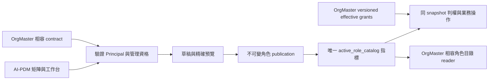

# DEV-123 可增減角色的權限矩陣與角色工作台實作契約

建立：2026-10-12；修訂：2026-10-21（Asia/Taipei）。Owner：`AIPDM/DEV-123#role-permission-editor`。狀態：`Local Implementation In Progress / Rollout Disabled`；**架構定案：已定案**（自用精簡見§14.5；本機證據見§15）。首版本機應用、DTO、API、UI、forward migration、dynamic reader與雙邊schema/vector已完成；授權等待與caller修正、實際證據及仍待逐案驗收範圍見§15.5；正式migration未套用、policy mode仍`DISABLED`、OrgMaster readiness仍`NOT_READY`，52案whole、browser/L4與正式啟用維持`NOT_RUN`。

本文件是第一版唯一產品及工程契約；[任務板](../dev_task.md#dev-123-role-permission-editor)只登錄狀態，[ADR](../decisions/ADR-PDM-ROLE-POLICY-001-versioned-app-owned-authority.md)記錄長期決策，[QA 計畫](../qa/qa-dev-123-role-permission-editor-validation-plan-2026-10-12.md)定義案例與證據。2026-10-21依使用者`/goal`授權進行AI-PDM與OrgMaster隔離工作樹的本機協同實作；此狀態不是Release Ready，也未授權正式migration、部署或資料寫入。

## 1. 人類決策與第一版邊界

人類來源：2026-10-12確認JF-FMS操作、OrgMaster人員指派分工、七日常角色/五作業及合併動作，並選擇「停用並停止該角色授權；保留指派與歷史，恢復角色後可再次生效」。2026-10-19明示內部自用並同意依五項審查精簡流程/鎖/storage/證據/實作裁量；2026-10-21再授權以ORGMASTER/DEV-058為主、AIPDM/DEV-123協同完成本機實作。七角色與必要權限保護不變，詳§14.5及§15。

AI-PDM 定義角色業務能力，OrgMaster 唯一管理人員指派、scope、有效期、代理、撤銷及特權任用。權限目錄是 application-global：一次啟用影響所有公司的相同角色，實際存取仍受各指派的公司／專案範圍限制；第一版沒有 company overlay。只有符合 §4 的直接 global 系統管理員能改動這份全系統設定。

包括：七個日常角色及自訂業務角色、五個作業分組、每格獨立的合併動作控制；新增／停用／恢復非受保護角色；生效版本查閱、草稿建立／選取／保存／取消未保存修改、矩陣與單角色工作台、差異預覽、差異確認及一次原子套用、查原操作結果、歷史查閱及從歷史建立新草稿。下載判權、作業辨識與既有caller接入是本版必要的授權改造；不新增模型獨立審批流程或補完退役業務。不新增第二人核准；同一合格管理者可完成發布與啟用。

排除：物理刪除／重用角色ID、已發布角色改名／改metadata、複製角色並繼承受保護能力、在AI-PDM任用人員、增加任意capability、修改scope／既有角色優先序／禁止自審、補完未支援業務、中央permission service、JF-FMS修改、Platform／IAM／Secret／traffic操作。

| 顯示順序 | 日常角色 | 權限設定的stableRoleId／roleCode | 舊身份相容與限制 |
|---|---|---|---|
| 0 | RD | `role-rd / rd` | 原displayName「研發人員」保留於身份／歷史，presentationName顯示RD |
| 1 | RD主管 | `role-rd-manager / rd_manager` | 原「研發主管」身份不改；仍驗指定reviewer及禁止自審 |
| 2 | QA/QC | `role-qa / qa` | 合併審核包含最終核准，預設不授審核 |
| 3 | 生產人員 | `role-manufacturing / manufacturing` | workspace與任用期間不改 |
| 4 | 採購／生管 | `role-procurement / procurement` | canonical設定沿用採購ID；`role-production-planning / production_planning`成為source固定的legacy-only相容別名 |
| 5 | 外部專員 | `role-external-specialist / external_specialist` | project-only、manual direct、有限到期、不可代理；只看已交付且明確共享到該project的資料 |
| 6 | PDM管理員 | `role-pdm-admin / pdm_admin` | 業務動作可編輯；管理資格仍受§4 protected任用控制，不能因名稱取得寫入資格 |

七角色是**日常權限profile**，不是刪掉兩筆歷史身份。九既有身份欄位stableRoleId、roleCode、displayName、assignable、risk、subjectKind、recommendationAllowed、delegationAllowed、allowedScopeKinds、assignmentTier、metadata與原displayOrder 0..8精確保留合法基線。另由source registry定義presentationName／presentationOrder、permissionRoleId及assignmentDisposition，不覆寫身份欄位。custom身份在九prefix後append，UI在七日常role後append；catalog順序與UI順序分開。

`system_admin`保留hidden-protected的維運／復原及特權任用身份，不放日常矩陣或一般新增角色選單。全部legacy能力保留；首個dynamic版本增加§3固定20個業務action的source保護值（每code mapped legacy無false時加allowed:true，有false則不加allow並保留唯讀deny），不能由草稿勾選、複製或停用。它不是第八個日常業務角色，也不把global能力轉給pdm_admin。需查受保護身份時以只讀詳細資訊顯示。

採購／生管不新增第十個ID，不重寫OrgMaster指派：production_planning指派先按原ID/code及原history驗任用，判權時只將permissionRoleId指向procurement，原scope／到期／代理／priority slot仍取原指派。canonical與alias的roleStatus須同步，alias不接受獨立能力／狀態編輯；停用／恢復採購／生管一次影響兩種既有指派。既有兩角色的舊permissions保持各自原值，新20個業務action只存canonical，alias不得自行存第二份授權。OrgMaster新任用只選七canonical角色及active custom；舊生管身份可查、可撤銷、有效期間內仍可用。雙角色同時持有仍逐指派檢查scope與原priority，不做scope union或合併任用記錄。

`system_admin`不可停用／刪除／複製；其餘七日常role及custom可停用／恢復，project-only外部專員不得改scope。不可把同Employee的另一Principal視為system_admin。

### 1.0 預設矩陣與首次轉換

下表是使用者已同意的**新政策草稿範本**，圖號、料號、模型／BOM、技轉交付四列各自有同樣起始值；之後逐列、逐動作勾選，互不連動。

| 作業分組 | RD | RD主管 | QA/QC | 生產人員 | 採購／生管 | 外部專員 | PDM管理員 |
|---|---|---|---|---|---|---|---|
| 圖號作業 | 查看、下載、編輯 | 查看、下載、編輯、審核、發布 | 查看、下載 | 查看、下載 | 查看、下載 | 查看 | 查看、下載、編輯、審核、發布 |
| 料號作業 | 查看、下載、編輯 | 查看、下載、編輯、審核、發布 | 查看、下載 | 查看、下載 | 查看、下載 | 查看 | 查看、下載、編輯、審核、發布 |
| 模型／BOM | 查看、下載、編輯 | 查看、下載、編輯、審核、發布 | 查看、下載 | 查看、下載 | 查看、下載 | 查看 | 查看、下載、編輯、審核、發布 |
| 技轉交付 | 查看、下載、編輯 | 查看、下載、編輯、審核、發布 | 查看、下載 | 查看、下載 | 查看、下載 | 查看 | 查看、下載、編輯、審核、發布 |
| PDM管理 | — | — | — | — | — | — | 查看（既有protected資格）、管理（另需§4特權任用）；鎖定 |

不因migration、建立草稿或換成七欄就改生效授權。legacy首次建草稿由server套用這份明確source範本，記`templateId='ai-pdm.seven-role-defaults.v1'`；所有新增20action、合併role、舊動作被替代及審核／下載的語意擴大均列首轉diff，管理者仍須保存、確認差異及套用。不是由舊key做OR推導；QA原先只有審查不會自動取得合併審核。legacy explicit-deny不得被範本解除：其涵蓋的作業action保持唯讀deny，差異列明，須另受控source決策才能解除。dynamic後建草稿從current精確copy，不重套預設。mode DISABLED只看原legacy真值，以「既有版本」標示，不能把預設範本冒充正式權限。

### 1.1 角色新增、停用與恢復

新增只輸入displayName，NFC/trim後1–80個Unicode scalar，與全部既有／停用角色identity displayName及source保留的presentationName精確唯一，避免自訂「RD」與內建RD重名。server生成UUID，`stableRoleId=role-custom-<uuid>`、`roleCode=custom_<uuid去hyphen>`；不能指定code、既有ID、alias、global／principal或特權metadata。模板assignable=true、risk=normal、subjectKind=employee、recommendationAllowed=true、delegationAllowed=true、allowedScopeKinds=[workspace]、assignmentTier=app_admin、metadata=null，profile為selectable、自指permissionRoleId；零permissions起始，只勾§3的20業務action，不繼承protected/legacy-reference、不提供自訂project/global模板。

生命週期欄位`roleStatus=active/inactive`與assignable身份屬性分離，所有dynamic角色都必填；legacy視為active且不改舊hash。停用只改roleStatus，原permissions與身份保留。草稿停用無授權效果；版本啟用後該角色的direct及delegated授權一律跳過，包含原有管理能力；仍有效的其他角色正常判權，不能因混有inactive grant把整個Principal判為contract mismatch。恢復同ID及同能力，版本啟用後僅當前仍有效、未撤銷、未到期、scope合法的指派／代理再次生效；OrgMaster撤銷或到期者不會復活。

第一版完整publication保留當前base所有身份及inactive tombstones，不提供物理DELETE；恢復不是新增同名／同code角色。source常數上限64個完整候選身份（含九起始、曾啟用後保留的停用角色及本次新增），不是整個history/identity registry的列數限制；超限422 `ROLE_LIMIT_REACHED`，可恢復停用角色，增加上限需source/規格修訂。此上限用於bounded驗證，不掃描人員決定是否允許停用。新增／停用／恢復與勾選先改同一份本地dirty草稿，由一次save原子保存，再一起確認差異→apply；尚未保存的新增項只是client暫存，可取消，並非物理刪除已持久化角色。停用確認清楚說明「啟用後停止此角色授權；保留指派，恢復可能再次生效」，全公司影響人數未知時不猜值。

## 2. 現況與權威資料路徑

只讀 source 基線：AI-PDM `main / d3fc1bf72b3630f8a748746c40584e595d396dac`；架構審查沿用前輪六份 AI-PDM 文件變更，不還原其他變更。此引用基線的source v7 是開發候選；已記錄 v6 與 v7 未部署的分界依 [DEV-121 CURRENT](DEV-121-target-authorization-boundary.md)。不能用未啟用 v7 取代實際 installed baseline。

先前外部只讀盤點metadata（2026-10-12）：OrgMaster `master / 49e25a7e422ef6f224037b497693a2732429a447`，JF-FMS `codex/對接orgmaster及platform / 5c970c734c02d75f9675757fd9adaeec672b7308`；HEAD不代表正式部署。讀取的是現有工作區檔案；兩repo dirty status因sandbox限制未能可靠讀回，標UNKNOWN，不宣稱clean或檔案全等於HEAD，後續owner重新核對。沒有修改其repo或執行tests/build/runtime。

現行 [catalog reader](../../src/lib/jenfu-principal-role-catalog.ts)把 DB active publication 與 bundled v7 精確比對；[workspace](../../src/lib/ai-pdm-published-role-capability-workspace.ts)與[UI](../../src/components/access-governance/role-capability-settings.tsx)唯讀。舊 `/role-capabilities/preview`、`/publish` 是退役跨 owner mutation，仍回 410。新功能使用獨立 `/role-policies` API。

055 建立的目錄表經 [062 schema boundary](../../db/postgres/062_dev010_neutral_schema_boundary.sql)移入 `ai_pdm_core`；不得依舊 055 名稱在 contract schema 再造一組表。

不新增第二份 permission override 或 per-request OrgMaster HTTP。每次受保護請求從同一 PostgreSQL snapshot 讀 active catalog、Principal／任用與資源；授權失敗／依賴未知即拒絕，不補入 cookie、legacy role 或舊版本能力。

雙reader以**該snapshot的active publication format**決定整次operation：合法legacy-static-v1沿原66key及既有caller/scope/share語意，source v7不能取代真實installed artifact；合法grouped-v2 dynamic才切新20action/profile/delivery/project guards。DISABLED部署及owner ENABLED但仍legacy active期間，不因缺20code中斷原業務；新動作只有dynamic apply commit後才授權。dynamic缺grant／hash/schema失敗絕不試legacy或舊指派能力；禁止混合format判權。QA36/46以雙分支及原session首轉證明。

## 3. 作業、動作及後端權限對應

### 3.1 固定作業與動作 registry

已交付source檔 `config/access-control/role-policy-editor-registry.v2.json`，contract=`ai-pdm.role-policy-editor-registry.v2`，roleSchemaId=`ai-pdm.role-schema.flexible.v2`；產生器與固定驗證入口會拒絕registry漂移。registry含roleProfiles、defaultTemplate、businessActions、legacyBindings、protectedBindings。profile列含stableRoleId、permissionRoleId、presentationName/Order、assignmentDisposition=`selectable/legacy-only/hidden-protected`；custom按固定模板推導，不接受body配置alias。此為本機source artifact，尚未migration或正式發布。

| groupId／作業列 | 範圍 | 同一role格內的獨立控制 |
|---|---|---|
| drawing／圖號作業 | 圖號、圖面、版次、附件及圖面辨識 | 查看、下載、編輯、審核、發布 |
| part／料號作業 | 料號、屬性、版次、附件及料號辨識 | 查看、下載、編輯、審核、發布 |
| model／模型／BOM | 模型檔、結構、零件關聯、model-basis及共享模型 | 查看、下載、編輯、審核、發布 |
| transfer／技轉交付 | 技轉套件、交付包、製造基準及採購接收資料 | 查看、下載、編輯、審核、發布 |
| admin／PDM管理 | 角色政策與既有設定；人員指派連至OrgMaster | 查看、管理；均protected唯讀，管理依§4資格 |

四個業務group × 五個action=`20`個可配置code，kind一律action，精確code為`pdm.<groupId>.<view|download|edit|review|publish>`；例`pdm.drawing.edit`。不得由label、任意前綴或使用者payload產生未註冊code。admin沒有可編輯的新code，沿用protected判權。每個businessAction含groupId/actionId/labels/order、kind/code、supportedScopeKinds、routeBindings/callerBindings、legacyOperationBindings、preservedGuards及byteDeliveryClass；所有method/operation discriminator及server resource resolver均須列入source。唯一checkbox key=`stableRoleId:groupId:actionId`，唯一業務code=`action:pdm.<group>.<action>`。

現有[active-capabilities](../../config/access-control/jenfu-active-capabilities.v1.json)的66key是**只讀盤點基線**，不是新畫面的66項。dynamic新增20key，registry共86個code：20業務editable、57 legacy-reference、9 protected；system_admin對20key是額外per-role protected值，不重複計code。9 protected固定為`accounts.identity.manage,accounts.invitation.manage,accounts.lifecycle.manage,accounts.session.revoke,settings.admin_matrix,settings.integration.manage,settings.manage,settings.secret.manage,settings.storage_evidence.view`，其餘原66中的57個key全部legacy-reference，原值保留、不再直接勾選。前版33editable/24reference分類已被取代，不能以舊33 coverage作新版本PASS。

### 3.2 動作的精確語意

| actionId／顯示 | 包含 | 不可由此動作取得 |
|---|---|---|
| view／查看 | 該作業允許範圍的清單、搜尋、內容、狀態與安全預覽；集合逐資源篩選 | 原檔／CAD／ZIP／CSV下載、編輯、審核、發布 |
| download／下載 | 原檔、附件、模型、BOM匯出、交付包及該作業匯出結果；仍須同作業view | 不繞過共享／資源範圍；不自動開啟編輯 |
| edit／編輯 | 建立、修改、附件增修移除／恢復、辨識執行／人工校正／正式化、草稿取消／作廢、送審及撤回送審；依既有合法狀態 | 最終審核或發布；不允許任意刪已發布主資料 |
| review／審核 | 原審查、審閱、核准、駁回、退回及合法決策套用；指定reviewer且禁止自審 | 發布；管理任用／特權 |
| publish／發布 | 已審核資料正式發行、交付／製造基準發行及既有發布失敗重試 | 不替代審核、不跳狀態、不新增supplier或外部分享任用 |

編輯及審核各是一個完整的業務動作，不把old keys拆成可另勾子項。授予edit讓所有已支援的create/update/submit/withdraw caller採用同一code；授予review同時涵蓋審查和最終核准，不能只保留review不含approve卻顯示勾選。業務target/owner/指定reviewer/no-self及流程狀態仍逐操作驗證。download須view AND download，其他四動作不互相自動授予；UI依view gate開作業頁，直接寫API仍檢查該action及既有domain guards，不以可開頁替代action。

指定reviewer的選擇／資格查詢在dynamic改用target所需review capability、有效scope及原human／業務條件，不能僅靠固定rd_manager/qa enum而讓合法custom角色永遠不能審核；不自動指派reviewer。實際決策仍須原request指定者、no-self及狀態；legacy保持原資格。CG123-01含正常custom reviewer正例。

### 3.3 既有能力及caller映射

下表舊code省略kind時為action；page另外註明。它是**caller語意對應**，不把同一個泛用old key複製成兩份新授權。dynamic caller只向當前publication請求新code，old allowed:true不作fallback；舊explicit-deny仍是限制。帶多類資源的操作須逐target／sub-operation取必需code，不能選一個較寬的group放行。

| target／新code | 既有code或交付面 | server選group及額外guard |
|---|---|---|
| drawing.view | page `numbering.drawings.view`；`numbering.workspace.view,submission.view,approval.inbox.view`的圖面讀取；drawing workbench/history/preview | 由canonical drawing ID、drawing-revision-work或review target決定drawing；只回合法圖面結果 |
| drawing.download | drawing附件／revision-files、`pdm/file-assets/[fileAssetId]`原檔、圖面export結果；原page/view檢查不再足夠 | 資產與圖面／parent關聯由DB決定，view AND download；匯出建立及結果取回都重驗 |
| drawing.edit | `numbering.create,numbering.attachments.manage,numbering.candidate.review.submit,numbering.draft.obsolete,numbering.draft.update,numbering.duplicate_check,numbering.link_variant,numbering.task.update,numbering.notification.update,numbering.workspace.create,numbering.workspace.update,numbering.workspace.cancel,numbering.approval.request,numbering.approval.batch.create,numbering.recognition.run,numbering.recognition.review,numbering.recognition.formalize,pdm.file_metadata.detect,post_release_change`的drawing操作；`submission.create,submission.update`同類target | 圖面target及既有draft/work state；辨識是編輯內的校正，不是業務最終審核 |
| drawing.review | `numbering.drawing_revision_lifecycle_review,approval.request.decide,approval.request.apply,numbering.draft.admin_confirm,submission.review,submission.decide,submission.lifecycle.decide`的drawing target | 指定reviewer/no-self/允許review kind；admin_confirm只限原業務確認，不接設定特權 |
| drawing.publish | `numbering.publish,submission.retry`的drawing發行；既有已審核版次正式採用 | approval已通過＋版次／併發guard，不以edit/review代替 |
| part.view | page `numbering.search`；`numbering.workspace.view,submission.view,approval.inbox.view`的part讀取；parts workbench/search及part matrix基本屬性 | canonical part/root target；集合依各row的group及scope篩選，不能整包跨group回傳 |
| part.download | part附件／submission files、料號匯出／報告；`numbering.export.create,numbering.audit_report.generate`及page `numbering.reports`所產生的part bytes | view AND download；純報告資料可view，CSV/ZIP/原附件為download，不靠page reports |
| part.edit | drawing.edit欄所列泛用numbering/recognition/submission能力的part分支，加`obsolete_part_root` | canonical part-change-work/root、草稿作廢及既有生命週期；不能因drawing.edit寫part |
| part.review | `approval.request.decide,approval.request.apply,numbering.draft.admin_confirm,submission.review,submission.decide,submission.lifecycle.decide`的part／lifecycle target | review kind／指定reviewer/no-self；未遷移kind仍fail closed |
| part.publish | `numbering.publish,submission.retry`的part正式發行／既有發布重試 | 既有核准、發行狀態及canonical identity |
| model.view | `pdm.shared_model.view`；model-basis、BOM/relations與shared-model清單；對應part matrix中的model結構片段 | model owner／BOM parent從DB辨識；不能將part.view當model.view，回應欄位須裁剪 |
| model.download | shared model原檔、CAD、BOM export與含模型的package bytes | model.view AND model.download；若包內同時含drawing/part檔，逐類加view/download |
| model.edit | `pdm.shared_model.manage`；model-basis/BOM結構／零件關聯及模型附件的修改 | model.edit；若同時改parent料號或圖面，另需parent.edit；既有worker最終採用重驗 |
| model.review | 既有drawing/part/submission/review package中**確有模型／BOM審核target**的`approval.request.decide,approval.request.apply,submission.review,submission.decide` | model.review AND 所屬parent.review；沿既有審核流程，不創新model狀態或審核入口 |
| model.publish | 既有drawing/part/transfer發行中**實際發行模型／BOM快照**的`numbering.publish,transfer.package.publish,manufacturing.baseline.release,submission.retry` | model.publish AND 所屬parent.publish；僅引用既有已發布快照不要求重發布 |
| transfer.view | `transfer.package.view,handoff.published.view,manufacturing.baseline.view,integration.procurement.view,submission.view`的技轉資料 | transfer／published release package／baseline的company與target；resolve POST屬讀取不是編輯 |
| transfer.download | handoff/technical-transfer exports、release-package、integration procurement package、製造包及submission release-package bytes | transfer.view AND transfer.download；含原始設計檔的包另驗對應drawing/part/model下載 |
| transfer.edit | `transfer.package.create,transfer.package.update,transfer.package.review.submit,transfer.package.review.withdraw,manufacturing.baseline.manage`與技轉target的`submission.create,submission.update,submission.share` | 原draft／收件人及平台share guard；edit不新增外部人員／任用，不改public share authority |
| transfer.review | `approval.request.decide,approval.request.apply,submission.review,submission.decide,submission.lifecycle.decide`的transfer target | 既有transfer review package kind、指定reviewer/no-self |
| transfer.publish | `transfer.package.publish,manufacturing.baseline.release,submission.retry`的交付發行 | 已核准／可發行及併發guard；integration同步不由此啟用 |

剩餘特殊legacy操作明確處置：
- `approval.request.cleanup`維持原受控清理資格／kind限制，不轉成任意role的edit/publish，不新增清理權。
- `integration.procurement.manage`維持既有integration管理資格且還需transfer.edit；矩陣edit不授連線／同步管理特權。
- page `numbering.request,numbering.tasks`只決定既有導航／展示；dynamic各資源的view/edit gate決定可見與可做，不以page grant放行資料或寫入。
- `submission.share`沿既有受控共享contract；建立/撤銷分享需transfer.edit及每target的view，配送原檔需相應download。`/api/public/shares/[token]`及package在現行Principal模式**仍要求verified session**（見principal-readonly-share.ts），不可改成匿名；token證明已提供該分享、不是矩陣授權。final delivery每次驗當前接收Principal的policy/grant及分享expiry/revocation，不能靠token或舊policy快照補權；supplier回覆等未發布能力仍拒絕。

以上20列加特殊處置覆蓋原66key的語意；完整method/caller及資產delivery清單須在PDM-S1寫入registry、以`CG123-02`逐現有source路徑核對。沒有caller或Principal仍退役/不支援者明列`unsupported-retired`並保持原拒絕，不能新造success、新增業務流程或聲稱已支援。既有caller缺guard是PDM-S3必修；任一實際可用路徑無映射／下載未分類，禁止新policy啟用，不可用「reference-only」迴避。此文件表是設計契約，不是20action已有runtime enforcement的證據。

### 3.4 格子、scope及判權

- 狀態為`granted/absent/explicit-deny`，protected／unsupported-scope／legacy detail有readonlyReason。editable勾選存`{kind:'action',code:'pdm.<group>.<action>',allowed:true}`；取消只移除該allow，不新增false。未知code／aliasID／hidden-protected變更拒絕。
- legacy-reference舊entries及explicit-deny從baseline server copy。任一profile成員（含採購／生管alias）的mapped舊key明確false，該profile/action唯讀deny，不能被新allow覆蓋；old true不授新action。sysadmin新增20個固定保護action由source規則給值，mapped explicit-deny同樣保留限制；不讓UI修改。
- 四group view支援workspace、受控project與system_admin原global；download/edit/review/publish只workspace及protected global。external四列只可配置view，其他動作unsupported-scope唯讀；project view只走下文§3.6的已分享交付projection，不開一般內部workbench。custom只workspace，checkbox不改任用scope。
- 圖號／料號／模型／技轉group由server canonical resource及operation discriminator解析；create時從已驗父資料／固定route type解析，不信body.groupId或檔名、副檔名。缺resource owner、混合batch有未授target、未知entity type一律拒絕；寫batch原子全允許才寫，read集合只投影合法資料，不回未授數量／模型欄位。
- runtime沿現有priority-first evaluator：先驗每個原指派的身份／provenance，再解析permissionRoleId、檢查canonical及alias active、scope／期間；維持**原roleCode的priority位置**選第一個有new code的候選，absent跳過，false deny。source alias只production_planning→procurement一條，不循環、不任意轉system_admin；不合併scope/期間、不FMS union。custom按catalog順序在已驗DB完整legacy priority後append；仍只檢查實際指派的roleCode coverage，不寫priority表或以DEFAULT補序列。
- 新20code與page/action舊code的兼容映射只在source guard adapter，不是第二份permission overlay；dynamic authority始終為當前publication。lookup(new code)若profile有mapped frozen false，先回唯讀derived-deny（不新增false entry），即使新code absent也按原priority的明確deny處理；反之只取新allow/absent，不從old true推授。inactive只跳過該role，不能poison其他合法role。owner／reviewer、no-self、company隔離、流程及worker最終採用繼續檢查。

### 3.5 查看與下載的交付邊界

查看只能拿server產生的非原始安全縮圖／預覽衍生物及授權文字資料；把原PDF/CAD/附件以inline disposition返回、前端hide下載鈕、改檔名或同URL加preview參數，都仍屬download。純查看者若該格式沒有安全預覽，只顯示metadata及「無可用預覽」，不能回原bytes。此設計限制server交付原檔，不能防止有權查看者截圖／抄錄；不承諾DRM。

所有原檔／ZIP／CSV／CAD／BOM／release-package、Range請求、縮圖fallback、簽名URL、worker export及public share package均列byteDeliveryClass=`safe-preview/original/export-package`。original/export-package在建立任務、下載授權及**實際讀bytes**前fresh查active policy與source grant；不得發出可繞過下一請求撤權的長效公開／bearer URL。本版原檔由驗證後的應用delivery proxy取得，無新增object簽名/IAM/key權限；既有storage create/get-only限制保留。已在授權snapshot開始的read可完成，下一個GET／Range必讀新policy；不宣稱可追回已下載檔。包內全部實際配送檔必須逐group有view+download，不默默以部分權限漏檔產生錯誤交付包。

### 3.6 外部專員的project-view資料契約

source现況：`submissions.project_code`已有專案字串，`readonly_shares`只綁submission/token/到期而沒有project audience binding；workspace permission service目前projectCode=null。不能宣稱這已是project enforcement，也不能用company workspace當project。

本版forward-only在既有`ai_pdm_core.readonly_shares`增加`project_scope_key text nullable`（非空時不得空白；immutable，禁止runtime UPDATE），**舊列保持NULL，不回填、不由migration替舊token擴權**。既有建立分享API在合法share/transfer.edit及parent guards通過、locked Released submission／release package完整時，server從DB的非空project_code精確copy到此欄；body傳project_scope_key／projectScopeKey拒絕，無專案則NULL。既有share DTO可回`projectScopeKey`摘要供說明，不作人員任用或另外指定project。runtime僅在既有合法share INSERT時寫此欄；撤readonly_shares table-level UPDATE並只回授既有合法revoke/count/metadata欄位（依實際source列出），不回授project_scope_key，trigger禁止修改binding；SQL immutable trigger及column ACL列QA25/51。此欄不另建表、不寫OrgMaster project/grants；重新提供分享才產生新的binding。

外部入口沿既有`/share/[token]`→`GET /api/public/shares/[token]`，登入後由share token正常查看（不以猜token或直接URL代導航驗收）。server同snapshot驗Principal/company、token hash、share active且未到期未撤銷、submission Released、release package/manifest與原canonical target合法；取得非NULLproject_scope_key，與**當前DB submission.project_code及OrgMaster該原指派scopeKey精確相等**，不自行大小寫／前綴轉換或跨company推論。缺／不同／未知則拒絕；project碼更改不能用舊分享擴到新project。

只讀對照[OrgMaster v4 projection](../../../OrgMaster/db/migrations/029_dev057_human_business_principal_grants_v4.sql)：scope_key取原assignment.scope.value；validation.scopeKey()的project:value是治理去重鍵，不是PDM接收的scope_key。本契約比較raw scope.value與DB project_code，UI可說明專案碼必須一致；不在PDM改寫原任用或自行補前綴。這是工作區source證據，不是live provider讀回。

得到typed `ExternalProjectReadContext={principalId,companyId,originalAssignmentId,projectScopeKey,shareId,submissionId,releasePackageId,releasePackageSha256,decisionAt}`，全部server取得，不接受body authority。只回交付manifest／Released submission中各group授權的metadata、BOM/模型清單與既有安全預覽；沒有model snapshot/合法refs只回該交付的模型檔metadata，不能追到未交付內部live模型。逐欄／資源檢查group.view，不回未授內容及download URL。不列舉其他active分享或以project.view讀內部draft/search/workbench；沒有安全預覽不補原bytes。原package API仍驗Principal與token，再要求view+download，external預設且本版scope不支援download所以拒絕。

內部role正常導航不變；external正常登入可保留待開分享連結回到此入口。QA51的P1/P2／NULL舊share／project code改變／多group與到期／撤權都走此delivery path。無token或只持workspace時不能藉project勾選取得資料。

## 4. 管理資格與 request 安全

保留session v2、typed active Principal、account/company/authEpoch、撤權/session registry及published-grant完整檢查；不另建任用或可被矩陣自行勾選的管理grant。

| operation | 必要資格 |
|---|---|
| read（workspace/draft/preview/history） | 當前合法settings.admin_matrix或下列合格管理者；低資格DTO不揭露全公司人員/actor/reason |
| edit（建立/保存草稿） | 當前human_privileged Principal的direct global role-system-admin/system_admin指派，沿現有protected grant validator |
| apply | 同edit；在真正套用時重新驗資格/候選/base/consumer，不以先前可編輯或preview當授權 |
| command readback | 有當前read資格的原操作者或合格global管理者；server裁剪資料，POST replay仍驗該operation資格 |

同一合格管理者完成設定，不新增第二人核准或只編輯/只發布任用模式。PDM管理員的名稱、另一Principal、Employee推薦/代理、workload、users.role=admin、前端旗標或body actorId都不能取得global管理資格；system身份/恢復途徑受保護，矩陣不得停用它或改scope。

寫入限POST application/json，server驗既有[Origin規則](../../src/lib/request-origin.ts)及session cookie；production使用明確PDM_PUBLIC_BASE_URL或既有exact candidate origin，缺/null/跨站拒絕，不信任任意Host/X-Forwarded-Host，也不新增Secret。unknown/duplicate JSON keys拒絕，actor/scope/company由server取得。holder統計只呈verified公司；跨公司影響未知不能猜值。actor/reason完整紀錄限global管理者或符合資格的原command操作者，由server裁剪，不只UI隱藏。

## 5. 資料契約與 forward-only migration

### 5.1 資料責任與最小結構

唯一生效內容仍是 `ai_pdm_core.role_catalog_publications / role_catalog_entries / active_role_catalog`。套用成功後直接是active，舊版本retired；不建立可供後續啟用的DEV-123版本。既有legacy的draft狀態資料保留為只讀歷史事實，不恢復舊mutation。

預設新增四個資料集，欄位如下；原本與publication同生命週期的metadata併入既有publication，命令結果與異動紀錄合用append-only ledger。這是可直接實作的參考結構，RD可依§14.2採等效結構，仍須保存下列唯一性、欄位語意與ACL。

| 物件 | 必要欄位／不變條件 |
|---|---|
| `role_policy_state` | application_id=ai-pdm singleton；mode=DISABLED/ENABLED/PAUSED；activation_generation bigint>=0；baseline_catalog_version/hash、baseline_role_identity_hash、protected_policy_hash、role_schema_id=ai-pdm.role-schema.flexible.v2、role_profile_schema_id=ai-pdm.role-profile-schema.v1、registry_hash及語意registry_payload。baseline/schema/registry immutable，mode與enablement_ref text/enablement_binding jsonb僅owner控制；binding可NULL但ENABLED/PAUSED須完整，generation僅成功apply+1 |
| `role_policy_drafts` | draft_id UUID；candidate_catalog_version=ai-pdm.role-policy.+draftId UNIQUE；base_catalog_version/hash/generation、registry_hash、完整roles JSON、content_hash、revision正整數、status=OPEN/APPLIED、created_by/updated_by/timestamps、source_history_version nullable、template_id nullable、last_save_command_id nullable、applied_catalog_version/applied_command_id nullable。APPLIED時最後兩欄必填且內容immutable；一draft最多一個publication |
| 既有 `role_catalog_publications` 新增／重用欄位 | publication_format、canonicalization_version、role_schema_id、role_profile_schema_id、baseline_role_identity_hash、role_identity_hash、role_profile_hash、protected_policy_hash、registry_hash、policy_draft_id UNIQUE、base_version/hash/generation、confirmation_hash、command_id UNIQUE、publish_reason；原published_by存已驗Principal ID。dynamic必填，legacy新增欄可NULL；payload/bindings immutable，僅合法active→retired狀態可改 |
| `role_policy_role_identities` | stable_role_id PK、role_code UNIQUE、NFC display_name UNIQUE、origin=builtin/custom、identity JSON/hash、first_catalog_version FK；九baseline先登錄，custom僅apply首次claim，已發布身份不重用、不更改。presentation保留名另由registry檢查 |
| `role_policy_commands` | request_id UUID PK、actor_principal_id、operation=create-draft/save-draft/apply、request_hash、outcome=SUCCEEDED/REJECTED、original_http_status、result JSON/error_code、draft_id、catalog_version nullable、before/after tuple、diff JSON、reason nullable、completed_at。結果與異動同交易append-only；一列可含多項角色／能力變更，歷史摘要由此投影，不再另寫一份audit表 |
| 既有 `role_catalog_entries.role_status` | active/inactive NOT NULL；legacy預設active、不改舊hash；dynamic納hash。保留全部身份/tombstones；alias與canonical狀態同步、system永遠active；已發布entry immutable |
| 既有 `readonly_shares.project_scope_key` | nullable immutable text；正常分享API從合法Released submission.project_code取值，舊列NULL不回填；詳§3.6 |

上述FK可採同交易延後檢查以容納publication/command互相引用，不能以暫缺receipt完成commit。commands至少可按draft_id、catalog_version及completed_at查詢；draft/history列表用bounded keyset（預設20、上限50），詳細payload按需載入。不建自動清理worker，不刪publication/identity/命令紀錄。

rollout沿用`ai-pdm.role-policy-enablement.v2`：綁policyReaderCompatibilityId=ai-pdm.role-policy-reader.grouped.v2、roleSchemaId、roleProfileSchemaId、registryHash、baselineRoleIdentityHash、protectedPolicyHash，以及OrgMaster source/compatibilityRevision/enablementRef與有效整合／live consumer／owner證據引用。DISABLED可無binding；ENABLED/PAUSED須完整。此為首次切換及相容契約變更的技術條件，可引用既有有效release/CI證據；一般權限勾選不新增人工核准或逐次重做部署證明，不鎖隨custom增長的整份identity/profile hash。

沿用輸入保護：拒絕未知欄位／role／group/action、重複change、duplicate JSON keys、不合法Unicode/U+0000、unsafe integer及false新增。UUID lowercase、hash64hex、generation/compatibilityRevision為非負十進位字串；request預設512KiB、candidate1MiB、64完整身份、changes1240及roleChanges62的bound保留。reason為trim後1–240 Unicode scalar。actor由server Principal context取得，不能假定是UUID或由body指定。

### 5.2 正規化、hash 與讀取

新dynamic用[canonical-json.v1](../../src/lib/role-capability-canonical-json.ts)＋UTF-8 SHA-256，[server hash](../../src/lib/role-capability-canonical-hash.server.ts)為權威。roles按原catalog displayOrder，roleProfiles按相同stableRoleId順序，presentationOrder只供UI；permissions按kind:code、allowedScopeKinds按ASCII，metadata缺失為null、物件key canonical排序。先驗Unicode及safe integer，不依jsonb插入順序／localeCompare算hash。

registryHash只覆蓋規範性語意：contractVersion、roleProfiles、defaultTemplate、businessActions的group/action/code/editClass/supportedScopeKinds/交付限制、legacyBinding的kind/code/resourceKind/operation→required actions及protectedBindings。對各array用stable ID/語意key作ASCII排序，物件採canonical JSON；**不含route/caller檔案路徑、helper/測試名稱、證據引用或時間**。這些實作binding留在source/coverage manifest，由CG123-02驗實際route與caller，不以純重命名觸發跨app相容變更。JSON欄名映射不能改hash語意；legacy/dynamic依format分派。

dynamic `roleDefinitionHash=H(身份欄位＋roleStatus＋permissions，不含自身hash)`；displayOrder用roles array index，九起始順序不改，custom按首次加入順序append，inactive保留位置，不提供重排。`baselineRoleIdentityHash=H(起始九角色身份array)`固定；`roleIdentityHash=H(當前完整身份array)`可隨新增角色變，不含roleStatus／permissions／roleDefinitionHash。既有身份必須與immutable identity registry吻合，新custom必須符合§1.1模板。

protectedPolicyHash=H({systemAdmin:固定擴充角色,frozenEntries:其他baseline角色全部legacy-reference/protected/explicit-deny entries})。systemAdmin保留完整legacy身份與permissions、roleStatus=active，加入§3 source-fixed 20action，mapped false仍限制；不含衍生roleDefinitionHash。此v2保護值在migration核對legacy byte/hash後推導，不回寫legacy hash；dynamic sysadmin必與固定擴充精確相等。frozenEntries不含非system roleStatus及可寫20code，alias仍留自己原entries，新custom凍結內容須空。

roleProfileHash=H(完整source推導roleProfiles)。contentHash=H({format,applicationId,candidateCatalogVersion,roleSchemaId,roleProfileSchemaId,registryHash,baselineRoleIdentityHash,roleIdentityHash,roleProfileHash,protectedPolicyHash,roles,roleProfiles})；roles含status/roleDefinitionHash，catalogSha256=contentHash，actor/reason/publishedAt只入不可改紀錄。diff={roleChanges,capabilityChanges,profileChanges,policyTransition,scopeImpact:'application-global'}，依role/group/action排序，精確列新增/停用/恢復、alias、template及首轉語意。預覽不另存hash/expiry物件，確認綁定見§6；不可把展示名更換當任用identity改名。

legacy v5/v6/v7保留原byte/hash及獨立artifact deep equality，不重算舊hash。`requirePublishedPrincipalCatalog`同snapshot讀全欄位：legacy exact已核准artifact；dynamic只接受v2，重算所有hash、起始九身份／custom模板／roleStatus／完整凍結內容／source registry，回DB decoded catalog。不是移除hash check或強迫source v7，不能以role數增加誤判unknown legacy。

只允許request-local memo或以catalogVersion/hash/generation/registryHash為key的不可變內容cache；每次新protected請求必讀DB active tuple，不cache指標或授權結論，不從cookie/static補權。browser不保存權限authority；§6.2可選復原提示不是授權/成功證明，其缺失不阻止正常操作。

### 5.3 versioned projections

新增`ai_pdm_contract.v_application_role_catalog_v2`：v1全欄位加`publication_format,canonicalization_version,role_schema_id,baseline_role_identity_hash,role_identity_hash,protected_policy_hash,registry_hash,activation_generation,role_status`；role_status直接投影entries欄位，dynamic 9..64個完整身份列、displayOrder 0..N-1同header，九歷史ID為prefix，不把inactive從catalog漏掉。legacy維持九列／active，hash保留原算法。缺publication metadata／狀態或hash不一致即依賴失敗。v1仍同pointer及原欄位，不凍結舊版；不兼容flexible lifecycle的live reader不得啟用。

v2身份列另投影`role_profile_schema_id,role_profile_hash,permission_role_id,presentation_name,presentation_order,assignment_disposition`。header hash一致、仍9..64完整身份，七可選profile不等於七歷史身份。legacy的profile schema/hash為NULL、permission_role_id=stable_role_id，任用可選性按原identity／特權入口，不提前採alias或禁止新生管任用；legacy presentation_name=原display_name、presentation_order=原display_order，僅供解釋；OrgMaster未啟用前用原角色選項。dynamic啟用後才依source七profile/disposition及alias lookup；原display_name/display_order不換語意。

新增`ai_pdm_contract.v_role_policy_publications_v1`從既有publication/entries及新增格式欄查已提交history，保留原legacy歷史事實，DEV-123新dynamic只會是active或retired，無待啟用產品版本。shape同v2 role/profile另含lifecycle/base，不揭露draft、人員、command result或reason PII。不改`orgmaster_contract.v_ai_pdm_principal_effective_grants_v4`；任用原catalogVersion仍是provenance，不必等current policy。此契約已由migration 086及雙邊manifest實作，尚未套用；既有v1欄位不變。

### 5.4 migration 與最小 DB 權限

已新增`db/postgres/086_dev123_role_policy_editor_v1.sql`；forward-only、單交易、只涉及`ai_pdm_core`／`ai_pdm_contract`及版本化讀取`orgmaster_contract`，不改已套用migration。它建立draft/command/state/identity、35欄current/history projection、最小ACL、原子apply routine與server-owned share project scope；初始mode為`DISABLED`，未在本輪執行。

先核對實際installed legacy/dynamic基線、九身份及保護內容；未知則停止該遷移。新增欄位/四資料集與contract投影，state初始DISABLED/generation0；legacy role_status預設active，原byte/hash/permissions/pointer/priority/grants不改。已驗v5/v6/v7 history可補nullable格式metadata；更舊資料保留原狀並標unsupported-format，只讀、不從它恢復可套用草稿。不得順帶執行084/085、Principal fence、cleanup或其他資料切換。

既有055經062移入core，runtime權限必須核對有效table/column ACL及inherited membership。撤publication/entries/active pointer/state/identity的runtime直接INSERT/UPDATE/DELETE，只留必要SELECT；草稿允許bounded寫入，commands僅INSERT/SELECT且immutable。publications原metadata新增欄不另授直接寫權；分享project_scope_key的欄位限制依§3.6，不改無關schema/default privileges。runtime不得持DDL/owner或OrgMaster core權限。

參考實作為兩個narrow SECURITY DEFINER helper：管理命令取鎖helper及`role_policy_apply_v1`，不再分publish/activate。取鎖helper只用於管理命令及mode同步，不能被一般business guard呼叫。apply只接已驗command/draft/revision/hash/expectedActive/compatibility/confirmation/reason bindings，從locked draft取候選，驗完整性/保護內容/roleStatus/別名及CAS後完成全部寫入；不接任意SQL/table/target或full role payload。DB guard與server共同遵守同一transaction，session admission仍由server驗，不能把SQL函式稱為已驗人類session。

helper固定安全search_path、schema-qualified、無dynamic SQL、owner=migrator、撤PUBLIC EXECUTE且只授PDM runtime必要EXECUTE。server重算canonical hashes，SQL不以jsonb::text或新extension另建不相容算法。RD可採等效的最小DB寫入邊界，不以helper名字或數量當驗收；runtime直接改已發布內容、pointer或身份的負例必須拒絕。OrgMaster只SELECT兩個contract views及必要schema USAGE，無core/DML/helper EXECUTE。

## 6. API 與原子套用命令

參考前綴`/api/settings/access/role-policies`；私有API envelope=`ai-pdm.role-policy-workspace.v3`，no-store。成功含非空data，錯誤含code/correlationId及已知requestId。此前v1/v2只是未實作的文件提案，不保留平行mutation端點。RD可在同slice同步調整私有路徑/DTO及呼叫端測試，不改以下外部行為。

| method／suffix | 主要輸入 | 結果／資格 |
|---|---|---|
| GET /workspace | selectedRoleId、draftId可選 | active tuple/mode、完整roles、七profile/custom、groups/actionRegistry、admission={read,edit,apply}、compatibility及公司範圍統計；read |
| GET /drafts | bounded cursor/limit | saved摘要、nextCursor；read |
| POST /drafts | requestId、expectedActive、sourceHistoryVersion? | 建OPEN/revision1/hash，回draftId/candidateVersion；edit |
| GET /drafts/[draftId] | draftId | saved內容/base/revision/hash/status、last_save_command_id及套用版本/命令引用；read |
| POST /drafts/[draftId]/save | requestId、expectedDraftRevision/Hash、roleChanges、changes | 一次保存角色與能力，revision/hash、changed、roleBindings；edit |
| GET /drafts/[draftId]/preview | expectedDraftRevision/Hash | 即時計算diff、current expectedActive、compatibilityRevision及confirmationHash；read，不寫DB/receipt |
| POST /applications | requestId、draftId、expectedDraftRevision/Hash、expectedActive、expectedCompatibilityRevision、confirmationHash、reason | 一次建立immutable publication並切active，回ACTIVE、catalogVersion/hash、generation、previousActive、applyCommandId；apply |
| GET /publications | cursor/limit | 已提交版本history摘要；read |
| GET /publications/[catalogVersion] | version | immutable內容、lifecycle及裁剪後異動摘要；read |
| GET /commands/[requestId] | requestId | 原結果/outcome/HTTP status；不存在為COMMAND_NOT_OBSERVED，不能推論未commit；每次驗當前資格 |

`ActiveTuple={catalogVersion,catalogSha256,activationGeneration}`。預覽只針對saved OPEN draft，差異即時計算、不建preview表、不設10分鐘TTL或可獨立啟用版本。參考`confirmationHash=H({contractVersion:'ai-pdm.role-policy-confirmation.v1',draftId,revision,contentHash,expectedActive,registryHash,compatibilityRevision,diff})`；它綁定管理者看到的差異，不是授權token。apply必須重算並逐欄比對；draft/base/registry/compat變動需重讀預覽，沒有force或以舊preview放行。

roleChanges維持typed create/deactivate/reactivate；create只給clientRoleId及名稱，正式ID/code由server產生。changes維持`{roleRef,groupId,actionId,enabled}`，roleRef為既有stableRoleId或本次create的clientRoleId。先建固定模板/目標status（採購／生管同步alias），再由registry轉唯一code；alias/system/未知或readonly項、重複/矛盾change整批拒絕。原active或同批reactivate可編輯；原inactive且仍inactive不可改。所有合法變更同一save/revision/roleBindings，取消只丟本地未保存內容，省略saved role不刪角色；同hash回no-op且不加revision。

參考shape：roleChanges與changes皆必填array、可空；前者各項為`{type:'create',clientRoleId,displayName}`或`{type:'deactivate'|'reactivate',stableRoleId}`，roleRef為`{stableRoleId}`或`{clientRoleId}`其中之一，不能同時出現。roleBindings為`[{clientRoleId,stableRoleId,roleCode}]`，只能從可信response/readback取得。這些私有DTO可依§14.2同slice等效調整，未知/省略不得被解讀成清空權限。

legacy-base草稿採§1.0已確認範本，dynamic-base精確copy current，不OR轉換或反覆重套預設。history只能從verified grouped dynamic複製20action，保留current身份/status/frozen entries；未進current的已發布custom可依immutable claim加入並列diff。legacy或未知格式只讀、回UNSUPPORTED_HISTORY_FORMAT；inactive需明確reactivate。stale-base可save，但preview/apply必須與current三欄CAS相符。

### 6.1 交易、防重與結果不明

create/save/apply為三種mutation，採server requestId UUID及`ai-pdm.role-policy-command.v3` requestHash，包含operation/resource/已驗actor/exact typed payload（不含requestId）；changes按roleRef/group/action排序、roleChanges保持順序。相同ID只允許相同actor/operation/payload，已commit回原結果，不重做；不同binding為409 REQUEST_ID_REUSE。GET預覽不需要命令紀錄。

同一apply transaction：序列化相同requestId →取得管理資料所需的最小row locks →鎖等待結束後用當前DB時點重驗session/Principal/direct global grant →查合法replay →驗saved draft/confirmation、active三欄、consumer及固定保護 →claim新identity並寫publication/entries/格式metadata →原版retired/新pointer/generation+1 →draft APPLIED及command/diff紀錄 →commit。全部old或全部new；任何錯誤不留下半套或無receipt的生效版本。runtime只可走既定owner寫入邊界。

apply前以角色/狀態/action/profile/格式轉換的語意diff判斷是否有變更；只有新draft UUID、時間或candidate version不同不算變更，空diff回NO_CHANGE且不建publication。純role新增/停用/恢復或首次legacy→dynamic轉換仍屬有效差異。

草稿保存只對同draft revision防衝突；套用序列化同active pointer的競爭。**不鎖一般業務寫入、不要求所有POST新增全站SERIALIZABLE/advisory鎖框架**。可沿用provider既有isolation/retry或採row lock/unique/CAS的等效方案；重試需fresh snapshot/當前資格及同requestId，callback不可有HTTP/檔案等不可回復外部副作用。唯一鍵競爭／serialization／timeout先rollback，再以新snapshot查receipt，不能在舊snapshot把等待後看不到的結果當不存在。語法/Origin/admission未通過不保證有command；已入命令的domain拒絕可記REJECTED，零domain mutation。

UI送出時暫停該draft重複保存/套用。回應遺失先查原ID；若仍不明，標「結果待確認」，不顯示已生效、不自動換ID或重送。原ID可得時用同ID/exact payload重試；缺ID依§6.2讀server draft/已套用引用/history。即使另開tab或瀏覽器資料遺失，後端同draft唯一publication、revision/active CAS仍防止重複套用，不能依賴browser狀態。

| 錯誤類型 | 恢復 |
|---|---|
| 401/403：session或operation/Origin拒絕 | 重新驗身分/資格，零domain write；不fallback |
| 404：draft/version不存在 | 重讀選取；command 404僅表示尚未觀察到 |
| 409：DRAFT_REVISION_CONFLICT/ACTIVE_VERSION_CONFLICT/CONFIRMATION_STALE | 保留本地dirty，從current建立/重讀基準並確認差異 |
| 409：CONSUMER_NOT_READY/COMPATIBILITY_CONFLICT/POLICY_NOT_ENABLED | 原active不變，修復相容條件後重讀確認；不force |
| 409：REQUEST_ID_REUSE/DRAFT_ALREADY_APPLIED/NO_CHANGE | 查原結果或current；不重複產生版本 |
| 422/413：非法role/action/保護或scope變更、重名、限額/過大 | 控制旁顯示原因，整批零domain write，保留合法編輯 |
| 503：依賴不可用/交易結果未知 | 查receipt/resource狀態，不假定rollback或自動反向操作 |

### 6.2 瀏覽器紀錄為輔助

saved draft、最後保存及套用引用、publication與command為server持久化真值；選定draft可放URL，仍需server授權。sessionStorage可只記requestId/draftId/operation及版本供重登或reload查回，**不要求保存完整命令body，不把storage成功列為POST前置條件**。不可用、quota、損壞或無舊紀錄時仍可正常保存/套用；提示未保存修改可能無法跨reload恢復，不額外建立設定流程。

reload後先驗當前Principal/資格，再GET原command（有ID時）或server draft的last-save/applied引用及history，分開呈現原操作與最新current。未確認時不猜成功/失敗，不自動接續或重送；由使用者讀取server目前版本後明確操作，後端CAS/唯一套用保護仍必須成立。只在原ID/原payload仍可得時重送該命令，不以猜測資料重建舊payload。

跨Principal不載入前人的body/dirty/復原資料，遲到response不得套入新身分。重新登入相同Principal仍重驗當前資格；清本地紀錄不撤銷server命令。瀏覽器關閉導致未保存dirty遺失可明示，saved資料與生效版本不能遺失。儲存失敗不是權限或功能故障，不應卡住整頁。

## 7. 套用、生效與恢復

### 7.1 單一套用

`OPEN draft → saved revision → 差異確認 → 單一apply transaction → ACTIVE；舊版本RETIRED`。保存/預覽不授權；只有成功commit或可信readback才顯示「已生效」。publication內容永久immutable，恢復從history建立新draft再套用，不直接指標回切歷史。

取消獨立publish/activate命令、PUBLISHED_INACTIVE產品狀態及「重新預覽並啟用」恢復分支。理由及全app影響只在確認區一次說明；同一合格管理者操作，不新增第二人核准或延後啟用排程。

### 7.2 相容與生效時間點

沿用OrgMaster提案`orgmaster_contract.v_ai_pdm_role_policy_compatibility_v2`單列：application_id='ai-pdm'、consumer_id='orgmaster'、contract_version='ai-pdm.role-policy-consumer-compatibility.v2'、compatibility_revision bigint、supported_publication_format='dynamic-policy-v1'、supported_canonicalization_version='jenfu.canonical-json.v1'、supported_role_schema_id='ai-pdm.role-schema.flexible.v2'、supported_role_profile_schema_id='ai-pdm.role-profile-schema.v1'、accepted_registry_hash/accepted_baseline_role_identity_hash/accepted_protected_policy_hash（64hex）、consumer_source_revision（40hex）、enablement_ref text、readiness=READY/NOT_READY。accepted_registry_hash為§5.2語意hash；不比變動全identity/profile hash。缺失、多列、NOT_READY、未知schema/hash或revision漂移拒絕apply。不是每business request的OrgMaster HTTP依賴。

第一次切到dynamic前，仍需兩端真實current/history/任用往返、確認實際consumer版本及owner rollout條件；可共用有效CI/release/整合證據，不為每次勾選再做正式發布。marker不是live consumer已升級的獨立證明。state DISABLED只讀；ENABLED允許管理操作；PAUSED可save/preview但不可apply，當前業務policy保持有效。mode無產品API，權限設定頁不能自行開啟首次rollout。

生效語意改為：**apply commit之後開始的新授權請求，讀新active tuple/角色狀態；已通過判權的一般短請求可完成**。不強制取消/回滾進行中的合法請求，也不承諾所有舊write都先於apply commit。每次新請求仍fresh驗session/grant/scope及唯一active policy，不能靠cookie或cached active pointer補權。長任務的最終採用、匯出/原檔的下一次delivery/Range須開fresh授權snapshot重驗，不能沿用啟動時的allow。真正需要中止進行中操作的高後果流程另按該業務風險控制，不把全app寫入綁到一個policy鎖。

### 7.3 最小恢復

| 情況 | 可觀察結果／處理 |
|---|---|
| apply明確rollback | 原active/任用不變，無半套；修正後再確認 |
| commit後HTTP遺失或unknown | 查command或draft已套用引用/history；只有一個publication/command，不能自動再次套用或反向恢復 |
| draft/base/consumer在確認後改變 | 409，保留dirty，重讀差異；不force |
| 已套用內容需要恢復 | 從verified history建current-base新draft，只恢復可編輯差異，再確認/套用新版本 |
| 軟體要退回static-only reader | dynamic active不可直接downgrade；依既有release相容/復原規則處理，本文件不產生production操作 |

不改OrgMaster grants、不人工SQL改pointer、不down migration、不刪歷史或以臨時allow保底。

## 8. UI 與 JF-FMS 操作

正常入口仍為`設定 → 流程 → 角色與權限`（/settings/workflow）。[JF-FMS矩陣](../../../JF-FMS/components/configuration/capability-matrix.tsx)及[editor](../../../JF-FMS/components/configuration/api-catalog-editor.tsx)只參考操作：七日常role/custom為欄、五作業為列、同格垂直排列獨立動作，欄名進角色工作台。PDM沿自有判權，不複製finance/union/測試身分。

矩陣與工作台共用draft/dirty/revision/hash，切視圖不save；角色新增/停用/恢復及勾選一次保存或取消，server生成正式ID並回roleBindings。離開dirty給save/discard/stay；取消不刪已保存角色。alias/system放只讀詳情，採購／生管停用確認明說同時停止兩類舊指派授權，保留歷史。admin格為protected標示，不可自授管理資格。

主要流程為**編輯矩陣 → 確認差異 → 套用權限 → 查看異動紀錄**；需要保留工作時可保存草稿，點確認差異前若dirty可先完成同一save，不要求使用者多走一次表單。差異列role/profile/action、首轉template及alias，明說編輯含建改送撤、審核含審查核准、下載獨立；理由及「所有公司仍依任用scope存取」僅確認一次。技術ID/hash放詳情，不出現在正常操作主線。

| 畫面狀態 | 主動作／可見結果 |
|---|---|
| loading / 依賴失敗 | 載入／重試；不能把錯誤顯成空權限或可編輯矩陣 |
| active唯讀 | 合格者建立草稿；顯示真實active，pdm_admin仍依§4資格 |
| dirty / saved draft | 保存草稿或確認差異；取消/切視圖不丟未保存內容 |
| 確認差異 | 套用權限；無第二個啟用按鈕或待啟用版本 |
| CAS衝突 | dirty保留、重讀基準，不force |
| 結果待確認 | 查server結果；暫停該draft重複mutation，其他只讀導航仍可用 |
| 已生效 | readback原結果與current；有較新版本就各自說明，異動紀錄可追查 |

legacy唯讀若細能力不一致，顯示「既有權限不同」/indeterminate並可展開，不OR猜值或把範本當active。inactive角色保留可見入口，數量/人數僅verified公司且可可靠投影，未知顯unknown。Principal切換丟棄舊dirty/response；storage故障不阻止保存/套用。

沿用矩陣自身scroll/sticky header，document無橫overflow，checkbox有角色/作業/動作label、keyboard/focus及busy/error回饋。既有桌面1440×900/窄版390×844驗收保留，可用同一UI旅程覆蓋多項；FMS比對確認操作骨架，無須逐案重拍或追求像素一致。API/build成功不能代替真正UI結果。

## 9. OrgMaster 相容切片與授權界線

下表只是在AI-PDM文件中準備的外部依賴，**未授權OrgMaster開發，沒有native DEV／branch／commit或PASS**。canonical repo=`C:\VIBE CODING\OrgMaster`，來源=`AIPDM/DEV-123#orgmaster-compatibility`。人類後續授權該repo／動作／環境後才完整讀其AGENTS、確認HEAD/dirty/index並選本地native ID。既有DEV-121 RD v7相容授權不涵蓋本次grouped role policy。

| slice | 精確必要工作／預期surface | owner範圍及驗收 |
|---|---|---|
| OM-C1 current/history reader | `server/aiPdmRoleCatalogRepository.ts`、`applicationRoleCatalogRegistry.ts`讀PDM v2/current及history；legacy exact artifact及grouped-v2 schema/hash/profile validator | 只SELECT PDM contract；9..64完整身份，七canonical＋legacy-only alias＋hidden-protected及custom，驗固定registry/profile schema、canonical hash/status，不static fallback或union |
| OM-C2 任用DTO與provenance | `src/governance/aiPdmCatalog.ts`／types／`validation.ts`、`server/orgmasterGovernanceStore.ts`／`employeeRecommendationService.ts`及governance API支援custom/status/disposition/presentation | 新一般任用只active/selectable且scope合法；採購／生管新任用用procurement，不再新建production_planning。既有兩種任用／代理依原identity/version驗歷史，可查可撤銷，不能批量改ID/code/version/scope/期間。特權任用仍原入口 |
| OM-C3 owner compatibility projection | OrgMaster own forward-only migration／owner readiness輸出§7.2 compatibility_v2，支援grouped-v2及role-profile-schema.v1、接受exact registry/baseline/protected hash | 只OrgMaster自己的contract與readiness資料；runtime不寫PDM policy。PDM SELECT，不能由PDM建立或寫marker；v1 READY不能冒充v2 |
| OM-C4 指派UI與七角色呈現 | `src/components/GovernanceCenter.tsx`正常AI-PDM任用選單用presentationName/Order，active custom appended；歷史生管標「採購／生管（舊生管指派）」並可撤銷，inactive顯示停用 | OrgMaster維持人員指派；不加能力checkbox／角色定義／草稿發布器。system_admin僅原特權任用入口，PDM管理員名稱不取得human_privileged。holder/recommendation/代理在inactive時拒新任用 |
| OM-C5 真實往返與相容證據 | 正常任用/代理/特權、legacy→grouped A→B、custom增停恢復及兩類採購/生管原指派/race | QA29/30/44/52可共用一次連續L4旅程；原grants不改、scope/期間/priority保留、已撤/到期不復活。有效source/runtime/readback證據可供首次rollout重用，不逐案重建環境 |

`server/applicationRoleAssignmentStore.ts`現行是financial assignment，不屬AI-PDM切片。`historicalAiPdmRoleSnapshotMatches`保留legacy v5/v6/v7 allowlist，dynamic改讀原version的immutable history及重算hash/profile；不因不同active版本或展示名改為RD／採購生管就拒絕合法舊任用，也不能只憑同ID/name放行。未存hash的舊任用以owner immutable version→hash binding驗provenance，不批量回填；新command仍綁expected version/hash。sourceGrant及delegation仍驗原role及period/scope/subject，PDM policy lookup才解析permissionRoleId；原role priority coverage仍以原code。

必要依賴：PDM先提供v2/history/profile與ACL、DISABLED保留legacy → 兩端reader及真實任用往返可用 → 確認有效consumer/owner rollout → 允許單一apply。缺view/錯schema不能fallback；simulator只支持PDM本地層。首次切換的既有有效CI/整合/source證據可共用，不為每次權限變更重辦發布；這是相容依賴，非OrgMaster/正式環境施工授權。

新任用由OrgMaster owner snapshot比較expected catalog及status/disposition：PDM先apply再建立任用snapshot則stale expected拒絕；重疊時合法舊snapshot任用可依舊provenance完成，PDM新授權請求依新policy/status。舊生管指派保留原scope、不補canonical grant；沒有跨owner core鎖或任用commit永遠等最新catalog的承諾。QA30/44/52可同旅程驗兩分支。

明確排除：OrgMaster能力矩陣、角色自定義／刪除器、人員role重編或批量grant rewrite、特權自任用、scope擴張、financial治理改造、任意employee移動、OrgMaster core由PDM讀寫、Platform／IAM／Secret／traffic。JF-FMS只讀參考、不需修改。相容view ACL由各owner的migration交付，無跨app DDL。

## 10. RD 實作面與相依

下列切片已在隔離工作樹實作；實際檔案、固定驗證結果及仍待DEV-121／122收斂處見§15。名稱/拆檔仍可依§14.2等效調整，但外部資料、安全與相容不變條件不得放寬。

| 切片 | 受影響surface | 驗證出口 |
|---|---|---|
| PDM-S1 語意與映射 | role-policy-editor-registry.v2.json、contract/hash及route map/generator；保留語意hash與本地route/caller證據的分工 | 七profile/九身份/一條alias、五作業20action、66legacy完整去向，未知/deny/scope負例；CG02可先靜態驗 |
| PDM-S2 資料與套用 | role-policy repository/service/管理guard；forward-only新增四資料集、既有publication格式欄、entry status及share project_scope_key、contract views/ACL | draft/save/單次apply的原生PG原子性、CAS、防重/unknown、immutable/ACL；rollout初始DISABLED |
| PDM-S3 判權接入 | catalog/permission/request guard、entitlement/published-grant validator、reviewer selector、resource/operation adapters、project-share及byte delivery、worker採用 | 原scope/期間/priority/no-self不變；新請求/長任務重驗、20action/custom正反與CG01/02；一般business不取policy全域鎖 |
| PDM-S4 私有API | §6端點及route dispositions/map；無獨立publish/activate或preview命令 | 三mutation及GET預覽的資格/格式/CAS/receipt/未知結果；舊跨owner410維持 |
| PDM-S5 正常UI | role-capability-settings/settings-screen/navigation，matrix/workbench同draft；可選storage復原提示 | 編輯→差異→套用→異動紀錄真實操作；存儲不可用仍可用、狀態/keyboard/兩viewport、無跨Principal洩漏 |
| PDM-S6 收斂 | 重用/擴充既有適用runner與fixture，52案例和CG證據映射 | 受影響層級實證；原52/17AC不縮分母，真實OrgMaster案例依§9另取得執行範圍 |

各slice可依依賴分開完成，不能因L4未具備就阻止獨立PDM契約/DB/UI驗證，也不能以local結果宣稱whole/正式完成。不無關重構Principal/ACL、release adapter、worker資源或業務流程。route變更仍更新產生器/分類及有效source對應，不用原固定計數漏新route；套用方式不要求新建五套專用runner。

## 11. Release Impact 與必要停止條件

本功能未來有DB格式/ACL及consumer相容影響：forward-only migration、雙reader、單一active及真實OrgMaster相容仍必要；部署先DISABLED不自動改權限，不用program-only readonly例外代替DDL/DML，也不順帶執行其他未套用migration。既有protected CI/release/DB boundary規則不變。

只定義權限設定產品，不預寫production命令/capsule/PR/merge/流量或正式復原表。只改文件不跑app build/test；未來程式/SQL按受影響面選必要檢查，實際release依當前專案gate及人類指定範圍。

只停止受影響動作：未知基線/owner、破壞identity/protected/歷史、可用caller漏判權、consumer不相容、需擴新project/environment/責任或改正式資料。內部命名/拆檔/鎖法/工具替換可依§14.2完成並同步文件；不把正常技術修正變成人類重複核准。

## 12. 驗收條件

保留17項AC與QA123-01..52、CG123-01/02。2026-10-19已由使用者同意替換兩階段/全域鎖/storage硬門檻的舊oracle，詳QA案例與變更對照；保留目的與ID，不刪案提高完成率。相同旅程/參數化測試可支持多案，缺該層必要證據仍標未驗證。

| ID | 可觀察交付條件 | QA對照 |
|---|---|---|
| AC123-01 | 正常導航取得真實active、七profile/custom及完整歷史身份；資格拒絕不洩漏 | QA01/02/45 |
| AC123-02 | 五作業同格獨立控制、20action/66legacy完整映射，unknown/scope/body不得擴權 | QA03/09/47/48、CG01/02 |
| AC123-03 | 兩視圖同dirty/save/cancel，存檔/離開/重登/無storage仍可正常使用 | QA04/05/34/35/41/43 |
| AC123-04 | draft/active/retired/角色inactive及精確首轉diff可辨，不造待啟用版本或全公司人數 | QA06/20/46 |
| AC123-05 | 當前protected資格、CSRF/嚴格body與防自授；apply前撤權必拒絕 | QA02/07–09/35/45 |
| AC123-06 | 草稿不授權；apply後新請求讀新版，已判權短請求可完成，長任務最終採用重驗 | QA13–15/23/24、CG01 |
| AC123-07 | saved/確認/base CAS、防重、all-or-nothing及unknown查回；不依賴browser硬門檻 | QA16–23/34/35/41 |
| AC123-08 | 原scope/期間/代理/priority/explicit-deny及reviewer/no-self保留 | QA10–12/45/51 |
| AC123-09 | 歷史/identity/hash/ACL immutable、命令兼異動紀錄、新版恢復及legacy provenance不改 | QA25–27/36/42/46 |
| AC123-10 | 正常UI、FMS操作骨架、desktop1440×900/narrow390×844、keyboard/error/data sanity；按相關旅程取證 | QA31–33/43/47 |
| AC123-11 | 真實OrgMaster current/history任用往返、compat錯誤/基準競爭拒絕 | QA28–30/36/52；29/30/52需L4 |
| AC123-12 | 增停恢復，其他role仍有效，恢復只採合法任用；system保護及alias同步 | QA37–43/45 |
| AC123-13 | custom任用、inactive歷史/撤銷、連續版本及零grant rewrite | QA29/30/44/52；可同一L4旅程覆蓋 |
| AC123-14 | 七名稱/順序、九身份、採購生管canonical/alias及原scope/期間/priority不合併 | QA45/52 |
| AC123-15 | 編輯/審核合併正確、不OR給QA或跨作業放行、body不得選group | QA46–48、CG01/02 |
| AC123-16 | view與download分開，原檔/匯出/Range/share/worker配送重驗，不用URL繞過 | QA49/51、CG02 |
| AC123-17 | model與parent必要action AND、外部project只已共享交付資料、不復活不支援流程 | QA50/51、CG01/02 |

## 13. 文件狀態與交接

`Local Implementation In Progress / Rollout Disabled`。registry、DTO/命令/結果查詢、private API、UI、forward migration、dynamic reader與OrgMaster 14欄真實契約檢查已完成；固定入口及build結果見§15。完整52案、CG、完整原生migration/apply案例、真實browser、L4、required CI及正式啟用仍未完成，不得以本機PASS取代。首次apply維持由`DISABLED`與`NOT_READY`雙重阻擋。

## 14. Architecture Closure Review（2026-10-19）

### 14.1 本輪結論

使用者原始訊息已同意五點瘦身，明定保留七角色/五作業/必要保護、只AI-PDM文件。這是對前版內部流程的有意替換，產品資料/任用邊界不擴張。

2026-10-19架構收斂時只讀對照main及既有055→062 schema、catalog/guard/source與相關DEV文件：既有publication本來持有版本metadata，可擴欄而不必再建一對一表；同交易/讀取資格的command與異動用一份append-only資料投影；無延後啟用需求，preview可即時計算、apply一次提交。該段當時僅為RD契約檢查；2026-10-21的本機實作與驗證另記§15，仍不稱獨立QC。

### 14.2 RD可自行決定與必要回送

| 固定邊界 | RD裁量／處理 |
|---|---|
| 七角色/五作業、20action語意、九身份/alias、scope/有效期/priority/no-self、管理資格/恢復途徑、單一policy authority | 必須保持；不能藉技術重構擴權、改OrgMaster任用或刪歷史 |
| 原子套用、正確衝突/防重/未知結果、每次新請求及長任務最終採用判權 | 固定結果；可決定transaction isolation、row-lock/unique/CAS組合、helper數量及私有confirmation格式，附對應正反/競爭實證，不強制全站policy lock |
| 資料/API參考結構 | 可合併同owner/生命週期資料、選欄/索引/檔案/module/私有路徑及DTO；同步受影響schema/types/callers/QA/本契約，不另等人類核准。未占migration ordinal在實作時選 |
| 外部versioned views及immutable已發布資料 | breaking變更仍需新version/相容窗口，不能把技術裁量當owner/授權擴張；本輪OrgMaster只列相容範圍 |
| 測試/證據/效能 | 可重用適用runner/fixture、參數化、同一旅程覆蓋多案、run層共用metadata；保留52驗收目的與層級。沿既有timeout/連線限制，不新增未量測SLA或強迫每case完整紀錄 |
| 要回送的真實差異 | 改角色/能力/生效語意、資料或人員責任、外部契約、不可逆效果/新環境等才停止受影響部分並收斂；一般私有API、hash/helper/鎖法等效修正可直接做並更新文件 |

完整caller/下載/外部scope適配、真實OrgMaster及正式rollout是已定義的後續工作，不以source目前尚未有此功能當未決架構。模型獨立workflow、自訂project/global角色、優先序重排、解除legacy explicit-deny及多租戶/SaaS機制不屬本輪；有實際人類需求才重進規劃。現有company/project隔離因真實資料授權保留，不因自用而解除。

### 14.3 前次審查摘要（HISTORY_ONLY，2026-10-12）

前輪修正priority過度限制、角色autosave與取消不一、reload未知結果、等待後期限及一對一lifecycle表。保留其來源與安全目的；當時兩階段/硬checkpoint/三函式及33細key分類不是CURRENT指令。

### 14.4 七角色決策（產品語意仍有效）

七role/五作業/同格動作、查看另分下載、編輯合建改送撤、審核合審查核准及保留九身份/固定alias於2026-10-12確認；已納§1/3。原44案加人類新增scope八案形成52，未因本輪精簡縮分母。

### 14.5 自用五點精簡（CURRENT，2026-10-19）

| 已同意審查項目 | 修訂與驗證 |
|---|---|
| 發布/啟用流程過重 | 單一apply、無待啟用版本；preview不落庫，metadata併publication、command兼audit；QA17–22/25/27 |
| business全面共用policy鎖 | 新請求採新版、既有短請求可完成；長任務/配送fresh重驗；QA11/23/24/49 |
| browser storage硬門檻 | 復原提示可選，無storage也可save/apply；server引用/ledger/CAS防重；QA20/22/34/35/41 |
| 每案整包證據與固定工具 | 保留52/17AC/CG，按層級取證、共用metadata/旅程、重用runner，只重驗受影響面；QA§4–6 |
| 架構凍結過細 | 固定結果/權限/資料/外部相容；RD可調私有API/資料/鎖/hash等效實作並同步文件；不新增人工關卡 |

本節記錄2026-10-19文件精簡階段；2026-10-21已依後續授權交付source/SQL/UI/API/tests與OrgMaster本機契約，不改既有release/CI gate。provider、正式資料、migration及traffic均未操作；目前狀態與證據以§15為準。

## 15. 2026-10-21 本機實作與驗證

### 15.1 已完成的實作項目（非整案驗收）

- `role-policy-editor-registry.v2.json`與產生器固定七個日常呈現、九個既有身份、20個業務action、66個legacy binding及九個protected code；自訂角色只可使用固定employee/workspace模板。
- `role-policy-editor.ts`、service、HTTP/schema、十個`/api/settings/access/role-policies`端點及設定頁面已接線；create/save/preview/apply/read-result與current/history DTO使用exact-key、size/origin、CAS及同ID重播控制。
- migration 086及前向087共同建立35欄current/history、draft/command/state/identity、原子apply與最小ACL；share的`project_scope_key`由server/trigger取submission，舊share保留NULL且不回填，只有新INSERT由server取合法submission的project binding，之後不可由runtime任意改寫。
- dynamic catalog reader驗完整canonical hashes/profile/alias/lifecycle；inactive角色不授權，production_planning保留原identity並取procurement permission profile。OrgMaster的真實v7 vector由AI-PDM domain builder產生，再由兩邊各自decoder驗證。
- submission detail與public share使用resource project scope；分享記錄的project binding缺失或不符即拒絕。管理API仍需verified human privileged Principal、AAL2及direct global `system_admin`。

### 15.2 固定驗證結果

| 入口 | 2026-10-21結果 | 支持範圍 |
|---|---|---|
| npm run test:dev-123:contracts（ORGMASTER_DEV058_ROOT指向DEV-058隔離工作樹） | PASS：Node 6/6；Vitest 48檔401/401 | registry、DTO/service、真實35/14欄與vector、dynamic reader/evaluator、圖號/料號route與指定reviewer、file/share正反 |
| npm run typecheck:app | PASS | 本輪應用型別 |
| node scripts/dev121-build-principal-route-map-v2.mjs --check | PASS：149 files／171 methods／181 entries | DEV-121路由地圖未漂移 |
| npm run check:db-boundary | PASS：DEV010_DB_RULESET_V1 | owner schema與versioned contract來源邊界；不是SQL執行/ACL證明 |
| npm run build:isolated | PASS：本輪0227，126 pages，artifact/primary/cleanup=true；主SQLite保持不存在 | 隔離Next build；既有middleware/Edge警告保留 |
| actual React component + mock API browser harness | PASS：10 checks、27 screenshots，1440/1024/390 | 已保存/已套用草稿、歷史建草稿、差異、busy、原ID查詢/重試、dirty切換、DISABLED readonly與disabled樣式；非正常登入及雙端E2E |

UI證據：output/qa/dev-123/ui-targeted-20261021/report.json、runtime.json及screenshots/。component SHA=ba47eef9c2fbd6b12c5f9da72f43e69d3a03bf66db82cfdecab97fa7725664e3，CSS SHA=4961951e53ba9c85948547189060a1aa3378291be8683fa7d330a2aac49dc67b；首欄84px、標籤與checkbox間距18.02px，三viewport/全部27畫面document均無水平overflow；browser/server已關且port已釋放。最初alias/fixture/transport/assertion harness失敗與修正前按鈕畫面均保留，不當產品失敗或正常登入驗收。

本輪追加：候選重算canonical/role/profile身份hash及受保護語意，apply DB邊界再次驗證；相同actor/原requestId/payload成功結果可在後續版本或readiness改變後重播；歷史只恢復可編輯能力，保留current身份/status/frozen；inactive合法指派不干擾其他active role；自訂審核者依target capability且保留指定者/no-self；圖號/料號固定route與實際review kind傳server resourceGroup，未適配caller仍保守AND，原有model追加限制保留。舊share回填已移除，external direct/unreleased/無share或project binding拒絕，package另驗download。

### 15.3 尚未關閉的條件

- 正向ENABLED atomic apply、CAS／replay／rollback及正常domain兩端生命週期已有PG18實證；正常登入HTTP/browser仍待驗證；manager等待撤權／grant到期／identity-link到期已有原生正反證據，但非normal OrgMaster v2 command或全案PASS。
- submission、原檔／ZIP、export讀取、Preview／recognition與transfer metadata已補caller；固定入口通過部分正反，完整20action/CG及正常登入UI尚未關閉。Owner／指定審核者限制保持；numbering export POST原Principal退休路徑未復活。
- 外部project share只傳server typed read context，package download拒絕並隱藏原包按鈕；新增share conditional已有獨立actual page/mock API browser證據；正常登入未驗證。
- 正式migration、required CI、正式L4／production未執行；QA52/24及CG分母保持。DEV121/122已納觀察main基線，不是上述本機工作的外部阻塞。

### 15.4 較早本機快照（HISTORY_ONLY）

以下保留各輪原始失敗、source及當時待驗狀態；目前續接以§15.5為準。

2026-10-21 forward-only修正：staged DB boundary首次拒絕修改已提交034/086（即使未正式套用），原始失敗保留；未放寬checker。034/086已恢復HEAD原文，新增OrgMaster 035_dev058_ai_pdm_compatibility_definer_read.sql與PDM 087_dev123_role_policy_candidate_validation.sql。035只授PDM受控apply owner唯讀contract權；087補候選DB驗證及source profiles，僅在DISABLED/generation0且無dynamic publication時，以table lock復原086導入的衍生project_scope_key，pre-087分享保持NULL，tokens/packages/其他業務欄位不變，新分享仍由DB綁定且不可修改。正式執行仍在本任務排除範圍。新序列staged boundary已PASS（OrgMaster25／PDM24 governed files），原生PG18重驗已PASS（下段）。先前只改034/086的native PASS是舊source實驗證據，不移用成新序列PASS。

2026-10-21新035/087原生PG18 fresh replay PASS：schema/ACL、雙邊contract read、候選內容正反、DISABLED拒絕及share binding/immutable均通過，維持NOT_READY/DISABLED。原始logs、fixtures、source hashes與cleanup統一引用OrgMaster QA§7及實作工作樹 output/qa/dev-058/native-pg-forward-only-20261021-010919/report.json，不重建多份證據台帳；非PG17 release、enabled atomic apply、正常登入UI、L4或production驗收。原始失敗及舊source結果保留。

本輪續接基線：最新main只增加兩個owner-release recovery script的修正，沒有app/SQL/worker變更；58個任務修改經保存/還原後逐檔SHA一致，證據在output/qa/dev-123/upstream-integration-20261021-0130-before.json及-after.json。新fresh-fence程式已完成隔離build：126頁、artifact/primary/cleanup=true，相關app/build輸入未因這次main合併改變，可重用；非正式source/release證據。

最新035/087 source的原生schema/ACL/validator smoke已PASS；首次loader啟動失敗、重跑結果及cleanup見OrgMaster QA§7與 output/qa/dev-058/native-pg-manager-schema-20261021-0133/report.json。新manager資格正例及鎖等待後的撤權/到期競爭仍未驗，不以schema成功冒充fresh授權行為已通過。

### 15.5 本輪續接（2026-10-21，0254）

本機核心整合已驗證，整體 DEV 仍 In Progress／正式 rollout disabled。

| 現行入口 | 實際結果與證據範圍 |
|---|---|
| OrgMaster test:dev-058:contracts | 7檔37 PASS／1 SKIP；包含三類發布入口、JSONB roundtrip、legacy／未知hash格式及減權／舊draft回歸。SKIP是未帶獨立PG環境的原案例；另有下列native實證，不改其原SKIP旗標 |
| AI-PDM test:dev-123:contracts | 48檔401 PASS＋Node6 PASS；typecheck／route map亦PASS，真實v7 vector及35／14欄契約一致 |
| Build／DB boundary | PDM0227 isolated build PASS（126頁、artifact/primary/cleanup=true，主SQLite原本不存在且仍不存在、容量lease已釋放）；OrgMaster final audit-id build PASS；另有受影響governance store/API/command三檔32 PASS；最終staged DB boundary PASS（OrgMaster25／AI-PDM26 governed files），diff/cached diff check均PASS |
| 隔離PG18 | actual PDM service create/save/preview/apply、同ID併發／重播、draft CAS、stale base與末端audit故障rollback PASS；actual OrgMaster decoder／v2-fenced指派與發布／PDM evaluator完整角色生命週期PASS |
| Targeted browser | PDM role editor actual component/mock API：10 checks、27 screenshots；share actual page/mock API：4 cases、4 screenshots，1440/390無console error／水平overflow。正常登入／HTTP全旅程不在此主張內 |

Native直接證據：OrgMaster實作工作樹 output/qa/dev-058/native-pg-bilateral-20261021-final/report.json。正常domain命令完成PDM新增角色→OrgMaster任用→PDM停用且立即不授權（Org任用歷史保留）→Org撤銷→PDM恢復且不復活任用→Org明確恢復，PDM才重新允許；最後generation=3。任用寫入走actual applyDraftCommand／publishGovernance與identity-fenced v2 writer，沒有用owner DML直接改測試中的任用。初始化workspace／governance／READY／ENABLED是明示owner fixture，Platform auth-state是stub、session為合成；不是正常HTTP／登入browser／Platform／PG17 release／production proof。八次原生執行的原始失敗log、後兩次PASS、來源hash及PID/start token／port／task root清理readback均已保存。

這輪實證找到並修正JSONB key重排造成的歷史來源誤拒。新V3 publication與audit使用optional hashFormat=orgmaster.sorted-json.v1，先JSON value roundtrip再排序object keys，array順序保留；三類TS publisher均在同交易補綁版本ID／snapshotHash的audit；版本綁定使用獨立UUID commandId，原business commandId／auditReference／receipt不改。共用append在同一write lock／transaction拒絕任何已存在commandId；實際FMS重用內部publication ID回COMMAND_ID_REUSED且零寫入，原命令重送仍回原receipt。無marker的舊版本及audit沿原exact hash，unknown marker拒絕；commandHash／舊commands.canonicalJson、已套migration與舊receipt未改。部署前須唯讀確認既有未標記V3 audit是否含巢狀detail.scope等資料且仍能通過原exact chain驗證；若JSONB排序已失去原preimage，需先另行處理相容性，不以新marker補算或放寬舊驗證；本輪未讀正式資料，不能假稱已確認無此舊資料；既有bootstrap／rekey producer保持legacy且未執行。Legacy catalog metadata只忽略object key順序，欄位集合／值及array順序仍須完全相同。

純減權發布依actual isGovernanceReduction與owner-bound歷史驗證，不把舊stored generation當live catalog CAS；新增／恢復仍驗current tuple、fresh actor及revision。切換active version時，舊draft只能用可信owner歷史證明可讀；authority仍取已發布版本，draft不能自行授權。

PDM已補submission list/detail/search的canonical group與分頁前過濾、原檔／ZIP逐成員view+download及storage前後重驗、numbering export讀取的實際內容群組、Preview／recognition完整verified initiator及worker當前Principal/session/grant／實際來源重驗。088保留舊job NULL且提醒重試；089將transfer metadata綁定新registry hash。Org035與PDM086～089只套於task-owned PG18，正式migration／資料／部署／traffic／IAM／Secret均未操作；source初始仍NOT_READY/revision0及DISABLED/generation0。

尚未關閉：正常登入HTTP/browser旅程、20action全部caller與CG01/02逐案驗收、QA24/52完整case closure、required CI及另行授權的正式首次切換。上述局部PASS只支持實際層級；不以mock browser或native synthetic session冒充正式L4。DEV121/122最新觀察main=8632026ebe1890672778d8d231ba8a0af3a7e3dd已合入PDM分支728b58e80c8655a6ec9b99fdfb2bfb2c8f8d0aa4，77個任務檔raw SHA保留；同範圍待驗不推成外部任務阻塞。
